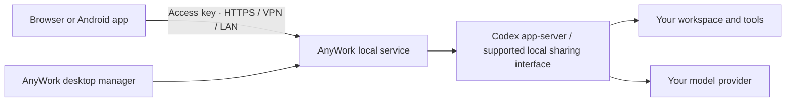

<div align="center">


# AnyWork

**Your local agents. Anywhere.**

Continue Codex or DeepSeek Harness from your browser or Android phone.<br />Your workspace and agent process stay on your own computer.

[Website](https://ywateru.github.io/AnyWork/en/) · [Download](https://github.com/ywateru/AnyWork/releases/latest) · [中文说明](README.zh-CN.md) · [Getting started](docs/getting-started.md)

[](https://github.com/ywateru/AnyWork/actions/workflows/ci.yml)
[](https://github.com/ywateru/AnyWork/actions/workflows/release.yml)
[](LICENSE)

</div>

## Leave the desk. Keep the context.

AnyWork gives agents running on your computer a remote workspace: streaming conversations, approvals, tool activity, files and previews. Codex also integrates subagents, diffs and a terminal. Open the same work on another screen, send a follow-up, or respond when the agent needs you.

The Rust desktop manager starts the local service and manages connection addresses, access keys and connected devices. Use a browser or the native Android app. There is no AnyWork-hosted account or mandatory AnyWork cloud relay; your Codex model calls still use your own account and model provider.

DeepSeek Harness is also available through its existing local Web/Desktop host: [shared-host setup and verification](docs/harness-setup.md). It preserves native session ownership and keeps Codex available alongside it.

Existing dsh and WorkBuddy histories can be browsed alongside Codex, including saved tool results while their host is disconnected. Desktop-managed services enable cross-project discovery; CLI users can set `--agent-scope all`. WorkBuddy shared desktop execution is experimental: see [setup and current acceptance limits](docs/workbuddy-launcher.md) and [history/synchronization details](docs/workbuddy-transcript-updates.md).

### What you can do

- **Continue the conversation.** Discover local Codex history, group chats by project, cache conversations and reconnect event streams. Attach to supported desktop sharing interfaces without starting a second execution engine.
- **Stay involved while work runs.** Queue or steer messages, see tool and subagent activity, answer approval requests, and receive browser completion and attention notifications.
- **Work with the output.** Browse files, preview documents and images, annotate image attachments, inspect Git diffs, and open a PTY terminal beside the chat.
- **Move between screens.** Responsive browser/PWA and a native Android host with connection profiles, file sharing and optional WireGuard support.
- **Choose your connection.** Local network, your own HTTPS proxy or VPN, Cloudflare temporary/named tunnels, or a configured WireGuard + TLS relay. The desktop manager can run multiple routes together.

## Download and connect

Get a package from [GitHub Releases](https://github.com/ywateru/AnyWork/releases/latest), or use the [bilingual download page](https://ywateru.github.io/AnyWork/en/#download).

| Platform | Package | Requirements |
| --- | --- | --- |
| macOS Apple Silicon / Intel | `.dmg` installer; drag `AnyWork.app` into Applications | macOS 14+; ad-hoc signed, not notarized |
| Windows x64 | Per-user installer or portable `.zip` | Windows 10/11, Microsoft Edge WebView2; unsigned |
| Linux x64 / ARM64 | AppImage or portable `.tar.gz` | GTK 3, WebKitGTK 4.1; x64 built on Ubuntu 22.04, ARM64 on Ubuntu 24.04 |
| Android | Signed universal `.apk` | Android 8.0+, current Android System WebView |
| Web / source | `.tar.gz` | Self-hosted deployment / development |

1. Set up the [Codex CLI](https://github.com/openai/codex) or an existing [supported Harness host](docs/harness-setup.md) **on the host computer**. Keep that computer awake while tasks run.
2. Open the AnyWork desktop manager, choose your workspace, and start the service.
3. Open the displayed address on your other device and enter the access key. For internet access, enable a tunnel or use your own HTTPS/VPN setup.

Desktop 0.1.1+ quietly checks and downloads updates, then installs only after confirmation. Use the Windows installer or Linux AppImage for automatic updates; portable directories update manually. Version 0.1.0 requires one manual upgrade. [Update guide](docs/updates.md).

The Android app connects to your host; it does not run Codex on the phone. Linux/Windows portable executables must remain beside their `resources` directory. macOS may require **System Settings → Privacy & Security → Open Anyway** after you verify the download. See the [installation and connection guide](docs/getting-started.md) for dependencies, CLI usage and troubleshooting.

## Run from source

Requires Node.js 22+, Rust stable with edition 2024 support, and Git. Configure Codex CLI or a supported Harness host for the agent you use; Harness 0.2.2-rc.1 separately requires Node.js 24.9+. Desktop builds also need the [Tauri system dependencies](https://v2.tauri.app/start/prerequisites/).

```bash
git clone https://github.com/ywateru/AnyWork.git
cd AnyWork
npm ci
npm run build
python3 scripts/source-archive.py
cargo build --locked --release -p anywork
./target/release/anywork --workspace /absolute/path/to/projects
```

Open `http://127.0.0.1:3210`. The access key is generated in `.anywork/access-token`. To discover all local projects, add `--codex-scope all`. To listen on your trusted LAN, add `--bind 0.0.0.0:3210`. Use HTTPS or a VPN across untrusted networks.

```bash
# Desktop manager (build the Web client first)
cargo fetch --locked
bash scripts/build-desktop.sh

# Android debug build: JDK 17, Android SDK 36, Build Tools 36.0.0
bash scripts/build-android.sh
```

Release packages are built by [GitHub Actions](.github/workflows/release.yml). Each desktop package includes the local server, Web client, licenses and corresponding source archive. Cloudflared is downloaded on demand with user confirmation. The optional `tunwg` helper must be installed/configured separately; see [desktop connection details](docs/desktop-manager.md).

## How it connects



AnyWork is a personal, trusted-device tool with the host user's file and terminal permissions. It is not a multi-tenant sandbox. Third-party tunnels carry traffic according to their own policies; a temporary Cloudflare URL can change when its process restarts.

### Current scope

Agent adapters support **Codex** and the official **DeepSeek Harness 0.2.2-rc.1** loopback HTTP gateway. Harness shares the original native host/session; install its optional discovery companion or configure the host address explicitly. Goal/plan, fork and message editing are not supported for Harness, and independent TUI processes without a shared carrier cannot be controlled. See [Harness setup and tested scope](docs/harness-setup.md).

Codex desktop sharing relies on version-dependent Unix interfaces, tested against Codex CLI 0.163/0.164 and the desktop versions recorded in the research notes; Windows desktop hot attach is not supported. CLI-backed work is available separately.

Full goal creation/resume/edit/delete needs a compatible shared engine; the desktop follower path supports reading and pausing goals. The interface checks these capabilities before sending. Cross-client native queues, voice dictation/read-aloud, and push after the browser has been closed are not claimed as implemented. See [capabilities and limits](docs/getting-started.md#capabilities-and-limits) before choosing a deployment.

## Development

Maintainers can publish with `python3 scripts/publish.py` (or `npm run release`): version bump, exact-commit CI, release builds, website deployment and resumable verification run automatically. See the [release guide](docs/releasing.md).

```bash
npm run dev                     # Web dev server
npm test                        # Web unit tests
cargo test --workspace          # Rust tests (desktop dependencies required)
npx playwright install chromium
./scripts/check.sh              # Integration and browser checks
python3 scripts/build-site.py   # Static bilingual website
node scripts/site-test.mjs       # Website browser checks
```

Tests use isolated fixtures and temporary services; they do not send tasks to your real Codex chats.

| Area | Source |
| --- | --- |
| Local API, persistence, event streams, files and terminal | `crates/server/` |
| Agent protocol and Codex adapter | `crates/agent-sdk/`, `crates/agent-codex/` |
| Harness shared-host adapter and discovery companion | `crates/server/src/harness.rs`, `integrations/harness-discovery/` |
| Rust/Tauri desktop manager | `crates/desktop/`, `desktop/ui/` |
| Shared browser / Android interface | `web/`, `android/` |
| Bilingual product website | `site/`, `scripts/build-site.py` |

[Getting started](docs/getting-started.md) · [Architecture](docs/architecture.md) · [API](docs/api.md) · [Plugin protocol](docs/plugin-protocol.md) · [Release process](docs/releasing.md) · [Contributing](CONTRIBUTING.md) · [Security](SECURITY.md)

## License and acknowledgements

[AGPL-3.0-only](LICENSE). Modified network deployments must provide the corresponding source; AnyWork serves its generated source archive at `/source`. Keep it current when deploying modifications.

AnyWork is an independent project, not affiliated with or endorsed by OpenAI. Codex and ChatGPT are trademarks of their respective owners. This distribution does not include their proprietary application modules or extracted avatar assets. Open-source reuse from [HAPI](https://github.com/tiann/hapi), AgentOS, Pierre and other dependencies is documented in [NOTICE](NOTICE) and [licenses/](licenses/).
