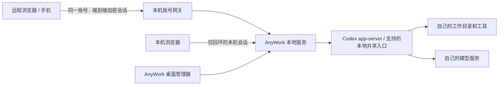

<div align="center">


# AnyWork

**任何时候、任何地方，完成任何工作。**

从浏览器和 Android 手机继续本机的 Codex 或 DeepSeek Harness 会话。<br />工作目录和 Agent 执行进程，始终留在自己的电脑上。

[产品官网](https://anywork.aixgg.com/zh/) · [我的设备](https://anywork.aixgg.com/app/) · [下载](https://github.com/ywateru/AnyWork/releases/latest) · [English](README.md) · [使用指南](docs/getting-started.zh-CN.md)

[](https://github.com/ywateru/AnyWork/actions/workflows/ci.yml)
[](https://github.com/ywateru/AnyWork/actions/workflows/release.yml)
[](LICENSE)

</div>

## 离开桌面，工作继续

AnyWork 为电脑上的 Agent 提供远程工作界面：流式对话、权限审批、工具活动、文件和预览。Codex 还集成子 Agent、差异和终端。换一个屏幕继续同一项工作，补充指令，在 Agent 需要你时及时回应。

Rust 桌面应用负责启动本地工作区，一键在浏览器打开。需要远程访问时，在电脑上登录并允许其他设备访问，然后在网页或手机登录同一账号、选择电脑即可继续工作。Logto 管理账号与最少设备配置，CyberGrid 负责协调连接；对话、文件、终端内容和端点私钥留在用户设备上。模型调用继续使用你自己的模型账号和服务。

也可接入已有 DeepSeek Harness Web/桌面主机，与 Codex 并列使用，保留同一原生会话：[共享主机接入与验证](docs/harness-setup.md)。

现可与 Codex 一同浏览已有 dsh 和 WorkBuddy 历史，主机未连接时也能查看已保存的对话和工具结果。桌面管理器默认开启跨项目发现；命令行可设置 `--agent-scope all`。WorkBuddy 桌面共享执行仍为实验功能，详见[接入及当前验收范围](docs/workbuddy-launcher.md)与[历史／同步说明](docs/workbuddy-transcript-updates.md)。

### 可以完成哪些工作

- **延续已有会话。** 发现本机 Codex 历史，按项目整理会话，缓存消息并恢复事件流。通过支持的桌面共享入口协作，不另起第二个执行引擎。
- **随时参与执行。** 排队或引导消息，查看工具和子 Agent 活动，处理权限申请，接收浏览器完成与待处理提醒。
- **直接处理结果。** 浏览文件，预览文档与图片，为图片附件添加批注，检查 Git 差异，在对话旁打开 PTY 终端。
- **在设备间切换。** 电脑浏览器、手机浏览器/PWA 和 Android 账号入口使用同一账号及设备列表。
- **打开自己的工作区。** 桌面一键本地打开，远程登录后选择已授权电脑；正常流程无需地址、共享访问密钥或隧道选择。

## 下载与连接

从 [GitHub Releases](https://github.com/ywateru/AnyWork/releases/latest) 获取安装包，或访问[双语下载页](https://anywork.aixgg.com/zh/#download)。本指南描述当前源码；已发布安装包以对应发行说明为准。账号远程宿主首先验收 macOS，其他平台范围见[支持矩阵](docs/support-matrix.md)。

| 平台 | 下载内容 | 安装要求 |
| --- | --- | --- |
| macOS Apple Silicon / Intel | `.dmg` 安装盘，将 `AnyWork.app` 拖入应用程序 | macOS 14+；临时签名，尚未公证 |
| Windows x64 | 当前用户安装版或便携 `.zip` | Windows 10/11、Microsoft Edge WebView2；未做发行商签名 |
| Linux x64 / ARM64 | AppImage 或便携 `.tar.gz` | GTK 3、WebKitGTK 4.1；x64 基于 Ubuntu 22.04，ARM64 基于 Ubuntu 24.04 构建 |
| Android | `.apk` 账号入口 | Android 8.0+、较新的 HTTPS 浏览器；优先使用 Custom Tabs |
| Web / 源码 | `.tar.gz` | 自托管部署 / 开发 |

1. 在**执行工作的电脑**配置 [Codex CLI](https://github.com/openai/codex)，或已有的[兼容 Harness 主机](docs/harness-setup.md)，执行期间保持电脑唤醒。
2. 打开 AnyWork，按需选择工作目录，点击“打开工作区”进入本地浏览器。本地使用不要求云端账号。
3. 需要远程访问时，在电脑端注册或登录，开启“允许我的其他设备访问”。其他电脑或手机打开[我的设备](https://anywork.aixgg.com/app/)，登录同一账号、核对电脑身份并打开工作区。

Native账号凭据和端点私钥只留在进程内存；退出桌面应用后，需要重新登录并开启远程访问，新公钥需要确认。关闭远程访问后，本地工作仍可继续。

桌面端 0.1.1 起支持静默检查下载，确认后安装重启。Windows 请用安装版，Linux 请用 AppImage；便携目录手动更新。0.1.0 需要先手动升级一次。[更新说明](docs/updates.md)。

Android App 连接电脑，不在手机上运行 Codex。Linux/Windows 便携程序必须与 `resources` 目录放在一起。macOS 下载后可能需要在核对来源后前往**系统设置 → 隐私与安全性 → 仍要打开**。完整依赖、命令行用法与故障排查见[安装与连接指南](docs/getting-started.zh-CN.md)。

## 从源码运行

需要 Node.js 22+、支持 edition 2024 的 Rust stable 和 Git。按所用 Agent 配置 Codex CLI 或兼容 Harness 主机；Harness 0.2.2-rc.1 自身另需 Node.js 24.9+。桌面构建还需要 [Tauri 系统依赖](https://v2.tauri.app/start/prerequisites/)。

```bash
git clone https://github.com/ywateru/AnyWork.git
cd AnyWork
npm ci
npm run build
python3 scripts/source-archive.py
cargo build --locked --release -p anywork
./target/release/anywork --workspace /absolute/path/to/projects
```

服务监听 `http://127.0.0.1:3210`，内部bearer保存在 `.anywork/access-token`，用于桌面与API鉴权。桌面应用选择匹配的数据目录后，通过一次性票据和HttpOnly本机会话打开Web，无需手动填写地址或密钥。添加 `--codex-scope all` 显示所有本机项目；远程工作使用同账号加密连接。

```bash
# 桌面管理器：先构建 Web 界面
cargo fetch --locked
bash scripts/build-desktop.sh

# Android 调试版：JDK 17、Android SDK 36、Build Tools 36.0.0
bash scripts/build-android.sh
```

[GitHub Actions](.github/workflows/release.yml) 自动生成发行包。每个桌面包包含本地服务、Web 界面、许可证和对应源码归档。Cloudflared可作为账号加密通道的内部实现；桌面不再提供独立匿名/固定隧道及WireGuard连接，详见[桌面和手机体验](docs/desktop-manager.md)。

## 连接原理



AnyWork 面向个人与可信设备，使用宿主系统用户的文件和终端权限，不提供多租户隔离。账号与协调基础设施处理必要身份和连接元数据，第三方中继只传送业务密文；首次设备目录与托管Web代码仍属于信任边界。

### 当前能力边界

Agent、版本、连接拓扑及平台的当前证据统一见[支持与验收矩阵](docs/support-matrix.md)，明确区分被动历史、夹具验证与原生写入验收。

Agent 适配器支持 **Codex** 和官方 **DeepSeek Harness 0.2.2-rc.1** 本机 HTTP gateway。Harness 沿用原有主机和原生会话，安装配套发现插件或显式配置主机地址即可接入。Harness 暂不支持目标/计划、分叉及消息编辑，也无法控制没有共享入口的独立 TUI。详见 [Harness 接入与验收范围](docs/harness-setup.md)。

Codex 已有桌面的共享协作依赖版本相关的 Unix 本地接口，已验证 Codex CLI 0.163/0.164 及调研记录中的桌面版本；Windows 不支持桌面热接入，可使用 CLI 会话。

完整目标创建、恢复、编辑和删除需要兼容的共享引擎；桌面 follower 路径支持读取和暂停目标。界面会在发送前检查能力。跨客户端原生排队列表同步、语音听写/朗读，以及关闭浏览器后的推送不在当前实现承诺中。部署前请阅读[功能与限制](docs/getting-started.zh-CN.md#功能与限制)。

## 开发

维护者执行 `python3 scripts/publish.py`（或 `npm run release`）即可自动递增版本、等待同一提交的 CI、构建发行包、更新官网并完成可续跑的核验。详见[发布说明](docs/releasing.md)。

```bash
npm run dev                     # Web 开发服务器
npm test                        # Web 单元测试
cargo test --workspace          # Rust 测试，需要桌面系统依赖
npx playwright install chromium
./scripts/check.sh              # 集成与浏览器检查
python3 scripts/build-site.py   # 构建静态双语官网
node scripts/site-test.mjs       # 官网浏览器检查
```

测试使用隔离数据与临时服务，不向真实 Codex 会话发送任务。

| 模块 | 目录 |
| --- | --- |
| API、持久化、事件流、文件和终端 | `crates/server/` |
| Agent 协议与 Codex 适配器 | `crates/agent-sdk/`、`crates/agent-codex/` |
| Harness 共享主机适配器和发现插件 | `crates/server/src/harness.rs`、`integrations/harness-discovery/` |
| Rust/Tauri 桌面管理器 | `crates/desktop/`、`desktop/ui/` |
| 浏览器 / Android 共享界面 | `web/`、`android/` |
| 双语产品官网 | `site/`、`scripts/build-site.py` |

[使用指南](docs/getting-started.zh-CN.md) · [架构](docs/architecture.md) · [API](docs/api.md) · [插件协议](docs/plugin-protocol.md) · [发布流程](docs/releasing.md) · [参与贡献](CONTRIBUTING.md) · [安全报告](SECURITY.md)

## 许可证与致谢

[AGPL-3.0-only](LICENSE)。修改后的网络部署须提供对应源码；AnyWork 通过 `/source` 提供生成的源码归档，修改部署时请同步更新。

AnyWork 是独立项目，与 OpenAI 无隶属或背书关系。Codex、ChatGPT 商标归各自权利人所有。发行版不包含它们的专有应用模块或提取头像。来自 [HAPI](https://github.com/tiann/hapi)、AgentOS、Pierre 等开源项目的复用记录见 [NOTICE](NOTICE) 与 [licenses/](licenses/)。
