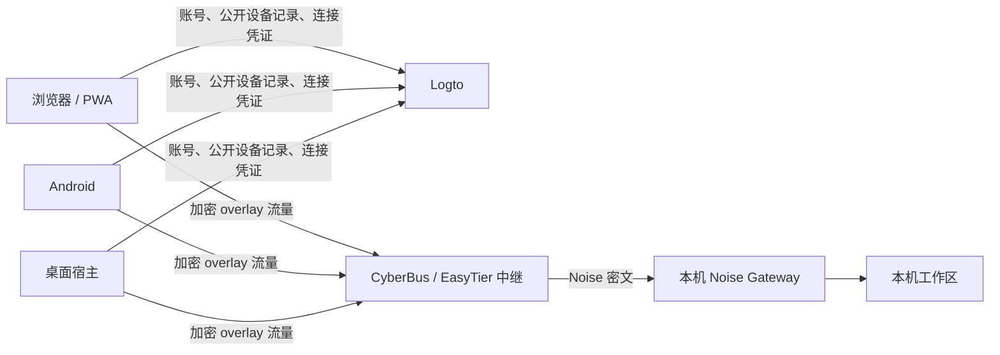

# AnyWork 账号、设备连接与数据边界

2026-11-22 · 当前 CyberBus 实现

本文是官网隐私说明所链接的当前数据边界。旧 CyberGrid/Upstash 设计已退役；历史评审只用于追溯，不代表当前部署。

## 简要承诺

AnyWork 云端处理账号和连接设备所需的最少元数据，不接收工作区业务明文，也不持有端点解密密钥。工作区对话、文件、终端内容、附件、工作目录和 Agent 原生凭据留在参与连接的用户设备上。

这不是“整个系统不处理任何用户信息”。Logto、CyberBus/EasyTier 中继、静态站点和网络基础设施仍会处理身份、设备公钥、IP、连接时间和必要的安全日志。

## 数据流

设备通过 Logto 找到同一账号下的公开安装记录，再通过 CyberBus overlay 到达桌面虚拟端口 `11001`。AnyWork Noise Gateway 在桌面本机验证账号 owner、JWT、客户端和期限，之后才访问本机工作区。

## 云端与设备上的数据

| 数据 | 位置 | 说明 |
| --- | --- | --- |
| 账号、认证因素、邮箱/用户名、登录会话 | Logto | 由身份服务按其配置和保留策略处理 |
| 登录与安全审计日志 | Logto 及部署基础设施 | 可能包含 IP、时间、客户端和事件类型 |
| 设备名称、平台、公开 Noise 公钥、`keyVersion` | Logto `customData` | 账号内可见；用于设备识别和首次公钥确认 |
| CyberBus locator：虚拟 IPv4、端口、产品、版本、时间 | Logto `customData` | 短期连接线索，不是访问授权 |
| 用户语言、外观等偏好 | Logto `customData` 和/或本地 | 不含业务内容 |
| CyberBus 网络材料、JWT、refresh grant | 端点内存或系统安全存储 | 不上传到 Logto 的业务字段，不进入 Web Storage |
| overlay IP、连接时间和必要中继日志 | CyberBus/EasyTier 中继及网络基础设施 | 用于建立连接和运行安全；不包含工作区正文 |
| 会话、消息、文件、附件、终端输入输出、Git 内容 | 用户设备 | 只在用户端点之间经 Noise 加密传输 |
| 端点 Noise 私钥、会话密钥 | 用户设备内存 | 不写入 Logto、中继或发布包 |
| Agent 原生登录和模型凭据 | 用户设备 | 由各 Agent/模型供应商按其条款处理 |
| 浏览器本机会话 cookie、PWA 缓存 | 用户浏览器 | HttpOnly 本机 cookie 或静态资源缓存；可退出/清理 |

## 端到端加密不等于所有元数据消失

AnyWork 使用 Noise IK 在浏览器/手机与桌面 Gateway 之间建立加密会话。CyberBus 中继和 EasyTier peer 可以转发密文，但不能取得工作区明文或端点私钥。

以下信息仍可能被基础设施看到或推断：

- 账号使用的 Logto 实例、应用、scope 和签发时间；
- 公开设备名称、平台、公钥和短期 overlay 地址；
- 连接 IP、端口、流量大小、时间和持续时间；
- 中继、反向代理、DNS、证书和主机安全日志；
- 静态站点、CDN 和错误响应的技术元数据。

HTTPS 终止、托管前端供应链、首次设备公钥目录和用户终端仍是信任边界。不能把“端到端加密”解释为对所有身份、流量模式或恶意终端不可见。

## CyberBus 凭证与设备发现

CyberBus `network:join` token 含可派生账号网络材料的 claim。客户端只在内存中验签和派生，不把 seed、network secret、PSK 或 binding ID 写入 Logto、Web Storage、日志或发布产物。

设备目录中的公开公钥用于首次 pin。后续公钥变化必须由用户对照桌面显示信息确认；不能仅凭账号目录静默替换。locator 过期、跨产品、越界地址或错误端口均拒绝。

删除 Logto 中的设备显示条目只更新目录，不等同于立即撤销目标电脑。真正关闭访问需要：

- 在桌面关闭远程访问，停止 Gateway/overlay/PTY 并撤下 locator；
- 退出账号或清除保存的登录授权；
- 需要时在 Logto 撤销会话/授权；
- 对本机 pin 或安装身份做相应清理。

## 保留与删除

- Logto 账号、设备记录和偏好保留到用户或部署管理员删除对应对象；认证日志按 Logto 实例配置保留。
- locator 由桌面每约 300 秒续期，TTL 600 秒。关闭远程、退出、授权失效或 overlay 退出时应删除；异常退出后的旧记录可能短暂保留到清理或覆盖。
- CyberBus/EasyTier 中继只应保留运行和安全所需日志；具体期限由部署方配置。当前没有 AnyWork 业务内容数据库可删除。
- 浏览器本地存储、cookie 和 PWA 缓存可通过站点数据清理或退出本机会话处理；桌面/Android 保存的登录通过显式退出或系统凭据管理删除。
- 模型调用由用户配置的 Agent 和模型供应商处理，不适用 AnyWork 云端删除承诺。

## 安全限制

- 首次设备公钥发现信任已登录账号的 Logto 目录；若要抵御恶意目录管理员替换首次公钥，需要额外的设备间安全码或二维码核对。
- 托管 Web 前端、浏览器扩展、恶意更新或被控终端仍可能读取其可见数据。
- 中继可见连接元数据，不能承诺匿名网络。
- 本机服务使用运行用户的文件和终端权限，不是多租户沙箱。
- 原生 Agent 可能按其自身设置向模型供应商发送内容，AnyWork 不改变该数据流。

## 运营者检查

部署方应：

- 只启用必要的 Logto 应用、scope、角色、回调和 CORS；
- 不把管理凭据、root key、token 或网络 seed 放入前端或仓库；
- 对 Logto、Caddy、CyberBus relay 和主机日志设置最小权限、访问控制和合理保留期；
- 为 TLS、证书、依赖和发布产物建立更新与回滚流程；
- 在隐私或数据流变化时同步更新本文和官网说明。

更细的授权、locator 和数据面实现见[CyberBus 迁移记录](cyberbus-migration-review.md)、[桌面账号契约](account-desktop.md)和[远程协议](account-remote-protocol.md)。
