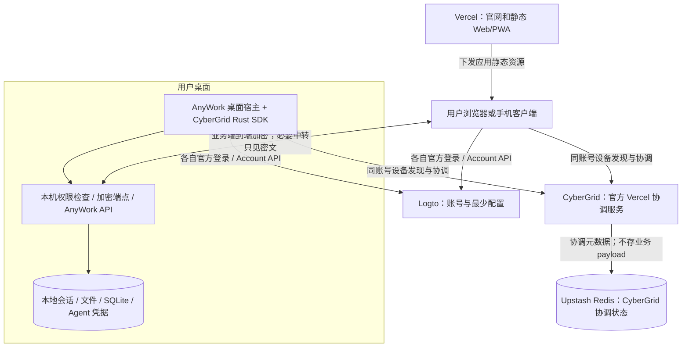

# AnyWork 账号、设备发现与云端入口改进方案

> 当前实施修订（2026-11-09）：用户要求直接在现有客户端增加注册/登录；本阶段使用现有 Development Logto，之后迁移自部署。此指示取代本稿中将 Cloud 生产套餐作为当前前置的安排，不进行付费升级。客户端入口、完整配置切换和重新授权见[当前任务](plan/tasks/account-client-entry.md)；历史调研/生产费用证据保留供后续评估。

状态：方案已获用户实施授权，隔离开发与独立审查中；以下验收通过前不宣称功能完成。日期：2026-11-09（Asia/Shanghai）。调研基线为 CyberGrid `1e6532893fbfa29619807a3ee66b389e57695a22`；实施已核对并固定更新后的 `2bd6729c6bbee90ed2926410caca883a0a100890`（补充 Vercel KV 环境变量支持，SDK 不变），替换上一轮单进程版本的部署结论。

**核心目标：AnyWork 运营侧不收集、不存储、不处理用户业务明文。云端需要持久保存的账号和最少设备配置统一放在 Logto；设备发现、在线信息和同步交换使用 CyberGrid；会话、文件、终端内容与 Agent 凭据留在用户设备上。**

AnyWork 不新建自己的 Redis/Postgres、云端 Control API、票据签发或业务审计库。Vercel 承载官网与前端，前端直接使用官方 Logto SDK、Account API 和 CyberGrid SDK。**用户已指定 CyberGrid 的 Redis 使用 Upstash；该存储只服务于 CyberGrid 协调，不新增 AnyWork 业务数据层。新版 CyberGrid 已支持 Vercel，可按上游正式部署方式配置。**

当前分工已明确：Logto 保存账号及最少配置，Upstash 保存 CyberGrid 必要协调元数据，业务内容和端到端私钥留用户设备。Upstash 中还包含 namespace 身份材料和注册 fence，不将它描述为仅有短期记录；删除/备份与最小化策略仍需验收。

证据见[调研记录](plan/analysis/account-device-cloud.md)，任务见[实施计划](plan/tasks/account-device-cloud.md)。调研阶段仅修改方案。后续实施已获授权；实际资源配置、源码提交和验收结果另记，不能将本方案视为已完成证明。现有已实现行为仍以[架构](architecture.md)、[API](api.md)和[部署](deployment.md)为准。

## 1. 用户流程与产品范围

1. 用户打开 AnyWork 官网，注册或登录 Logto 账号。
2. 工作电脑上的 AnyWork 完成独立登录，用户明确开启“允许我的其他设备访问”。本机绑定账号，启动 CyberGrid 并发布 AnyWork 能力。
3. 手机或另一台电脑的浏览器登录同一账号，直接看到同账号、同应用的在线设备；Logto 中的非敏感配置补充设备名称和离线占位。
4. 点击设备，客户端核对设备身份，与桌面建立加密连接。由桌面验证账号和本机权限后，进入现有工作区。
5. 切设备、断开、退出、关闭远程访问都在明确的用户动作下执行；不要求填写 URL 或拷贝长期访问密钥。

“访问桌面端”指 AnyWork 的 Agent 会话、文件和 PTY；完整系统屏幕、键鼠和远程桌面视频不在本次范围。首版个人使用，不新增团队共享或同一桌面多用户沙箱。网络接入不改变原生 Agent 的实际支持矩阵。

## 2. 安全目标与数据边界

### 2.1 数据放在哪里

| 数据 | 唯一持久位置 | 云端可见性 |
| --- | --- | --- |
| 账号、认证因素、身份和登录安全记录 | Logto | Logto 按其认证服务职责处理；不宣称无身份数据 |
| 最少设备索引、用户设备别名、外观和语言偏好 | Logto 用户 `customData.anywork` | Logto/租户管理方可能读取；必须为非敏感信息 |
| 在线状态、心跳、设备目录、信令 | CyberGrid 专用 Upstash Redis | 无业务 payload；实例重启不清除，按逻辑到期及后续请求清理 |
| epoch、注册回执派生 seed、注册 fence | CyberGrid 专用 Upstash Redis，namespace 生命周期 | 不全部具备 TTL；含敏感协调材料，不是用户设备端到端私钥 |
| 会话正文、代码、附件、文件、终端字节、工作目录、Git 内容 | 用户设备 | AnyWork 云、Logto、CyberGrid 不接收业务明文或业务历史 |
| 安装私钥、端到端密钥、原生 Agent 凭据 | 用户设备安全存储 | 不上传 Logto，不进入前端静态包或中央日志 |
| 连接会话、挑战、nonce 和重放窗口 | 两端本地内存 | 生命周期结束即清理；无中央票据/nonce 数据库 |
| 业务访问记录 | 用户设备，可选且有限 | 不上传业务审计到运营侧 |

Logto 自带认证日志和 CyberGrid 的必要协调元数据仍属于用户相关数据，不能声称“整个系统不接触任何用户信息”。准确承诺为：**运营侧不收集业务内容，基础设施不持有业务解密密钥；身份与必要连接元数据最小化。** 原生 Agent 自身向其模型供应商发送的数据，遵循原生账号和服务约定，不属于 AnyWork 云代转。

### 2.2 不接触业务明文的约束

- 业务通信发生在用户客户端与用户桌面之间；不经过 Vercel Function、日志采集、错误上报正文或集中同步 API。
- 经中转基础设施的业务流必须在客户端和桌面之间加密，解密只发生在用户两端；密钥不能从 Logto 取回，也不能由 AnyWork 云端恢复。
- 浏览器默认不启用会话回放、DOM/输入采集、第三方分析脚本；错误报告只用固定错误码和脱敏技术信息。
- HTTPS 不是浏览器到桌面的端到端加密证明。Cloudflare 会终止普通业务 HTTPS；若没有内层加密，该路径不能满足“中转设施看不到业务明文”的目标。
- 浏览器由托管站点下发的 JavaScript、用户设备、Logto 身份与初始公钥目录属于信任边界。站点供应链被攻破、恶意客户端更新或终端被控仍可能窃取明文；不能承诺仅靠这套架构抵御恶意前端发布者或所有身份基础设施攻击。
- 首次设备公钥发现信任 Logto 身份与目录的完整性；后续本地固定公钥，换钥需明确确认。若要抵御恶意目录管理员替换首次公钥，需要设备间安全码/二维码验证；不能把“公钥存在 Logto”描述成独立于 Logto 的信任保证。

### 2.3 不扩展云端存储的含义

用户已指定 Upstash 承担 CyberGrid 内部协调存储；不新增 AnyWork 业务数据层，业务内容与端到端秘密留两端。运行清单明确列出 Upstash 中的用户关联、网络地址、信令、会话 hash、持久 fence 和协调派生密钥，以及清理/备份策略。不将协调数据复制进 Logto，不在 Redis 中增加会话正文、文件或终端历史。

逻辑 TTL 不等于物理删除：上游使用 hash 和 expiry 索引，在后续请求中清理；闲置 namespace 的过期数据、持久 fence、AOF 或备份不能承诺到期即擦除。基础设施访问日志同样需脱敏和限制留存。不新增 AnyWork 业务数据库、对象存储或业务日志库。

## 3. 目标架构与配置边界



图中按用户指定使用 Upstash；调研阶段未更改资源，获实施授权后已创建专用 Logto 租户、Upstash 数据库与 DEV CyberGrid 部署，生产启用仍受套餐和完整验收门槛限制。不引入 AnyWork 云端 Control API。Logto token 由官方 SDK 管理，前端直接调用当前用户 Account API；CyberGrid JS SDK 使用宿主提供的 resource token 回调读取设备。设备授权由桌面验证，业务会话由桌面创建。

“主要在前端实现功能”适用于注册登录、设备页、配置读写和连接交互。当前本机服务仅支持固定 bearer，CyberGrid JS SDK 也不提供浏览器业务加密传输；**这些安全能力不能靠改页面或开服务配置自动获得**。所需修改落在用户桌面本地适配器及客户端传输层，不新增持久化云端后端。

## 4. Logto 配置与前端直连

### 4.1 可用能力已核实

Logto 官方 Account API 支持：

- 启用 Account API，并给 custom data 配置 ReadOnly 或 Edit 字段权限。
- 宿主请求 `UserScope.CustomData`（`custom_data`）等所需 scope。
- `GET /api/my-account` 读取当前用户资料；`PATCH /api/my-account` 更新 `customData`。
- 使用官方 SDK `getAccessToken()` 取得 **Account API 的 opaque token**；Grid resource 的 JWT 则用指定 resource 获取。这两种 token 不能混用。

这些能力让前端直接管理自身配置，无需把 Management API secret 放入浏览器。Account API 只操作当前用户，不允许由前端提交任意 user ID 读取他人配置。

### 4.2 服务配置清单

| 对象 | 配置 | 约束 |
| --- | --- | --- |
| Logto 租户 | 独立 AnyWork 租户；地区、Dev/Prod 与套餐核验 | 已创建 JP 生产 Free 与独立 Development 租户；生产 resource/角色额度不足，不能用开发租户冒充生产 |
| Web 应用 | 普通 SPA、授权码 + PKCE、精确回跳/退出回跳/origin | Vercel 生产与预览环境分开配置 |
| Native 应用 | 普通 Native，Device Flow 关闭；桌面与原生手机使用同一设备应用 ID | 保持 CyberGrid 同应用发现；使用 AnyWork 自己的回跳 |
| Grid resource | 固定 audience、`connect` 权限，匹配 CyberGrid | 验证实际 ES384 JWT、issuer、scope 与 client ID |
| 用户角色 | 新用户默认获得必要 Grid 权限，已有用户补配 | 注册完成即可发现设备 |
| Account API | 开启；custom data 按最小权限开放；客户端申请 `custom_data` | 用户可编辑字段不能作为可信管理员授权 |
| 登录体验 | 名称、标志、中英文、注册、邮箱验证、找回流程 | 邮件连接器和真实投递需验收 |
| CyberGrid M2M | 上游现有目录读取凭据，服务端保管 | 上游当前要求宽权限 `all`，不可下发前端；仅为已有服务配置 |
| CyberGrid Redis | 使用 Upstash；配置 TLS `REDIS_URL` 或成对 REST URL/token，二者互斥 | 仅服务端；环境 namespace 隔离，缺少存储不回退 RAM；不作为 AnyWork 业务库 |
| 前端公开配置 | issuer、SPA/Native 公开 ID、resource、CyberGrid 可信地址 | 不含 PAT、M2M/SMTP secret 或任何用户私钥 |

不创建用于云 Control API 的第二套资源/票据签名系统。若本机业务鉴权需要独立 audience，作为协议细化项评估；不因此引入新的云服务。任何原生多资源授权都必须由同一个 refresh grant 所有者管理。

### 4.3 Logto 中的最少配置结构

以下为拟定应用字段，不是 Logto 内置设备表：

```json
{
  "anywork": {
    "schemaVersion": 1,
    "preferences": { "locale": "zh-CN", "appearance": "system" },
    "devices": {
      "installation-id": {
        "label": "工作电脑",
        "platform": "macos",
        "gridDeviceId": "public-coordination-device-id",
        "publicKey": "public-device-key",
        "keyVersion": 1
      }
    }
  }
}
```

只保存用户知晓可见的别名、平台、随机安装标识、公开协调设备 ID (`gridDeviceId`) 和公开公钥。`gridDeviceId` 仅用于将协调目录与安装索引对应，不用于授权；账号权限由桌面验证，公钥仍绑定安装身份。工作目录、IP、当前 tunnel URL、最后会话标题、在线心跳、会话摘要、文件名、访问密钥、refresh token、私钥、加密主密钥都不放入 `customData`。设备显示名可能包含个人信息，默认使用中性名称，并允许用户改名。

设备数量、条目长度与整个配置体积设应用上限，并核验租户/API 配额；不能默认这是无限容量数据库。不上报业务事件来占用 customData。避免把整个设备目录自动复制进每个 JWT claim。

### 4.4 整体覆盖、并发与可信性

官方 API 明确：更新 `customData` 会**整体替换**原内容，不能只发送 `anywork` 就假定保留其他字段，也不能假定支持 ETag/CAS 或原子设备增删。

- 写前读取最新完整 customData，保留所有其他命名空间；只在本地合并 AnyWork 的目标字段。单客户端串行写入，写后再读核对。
- 多设备同时写仍可能丢更新。版本号、写后读取和有限重试只能检测部分冲突，不能提供线性一致性；不把这套做法包装成分布式事务。
- 初版尽量减少写入：偏好/别名由显式操作更新，安装索引由桌面绑定时登记；在线设备以 CyberGrid 实时发现为准。检测到自己的索引缺失时，重新拉取并提示恢复，不无限覆盖。
- 若纯配置方案无法满足并发可靠性，降级为“Logto 保存偏好、CyberGrid 显示在线设备”，离线设备索引暂缓；不能自行增加数据库或把频繁协调状态搬进 Logto。
- customData 为用户可编辑和管理员可读数据，不作为角色、owner 授权、撤销名单或一次性票据消费记录。`schemaVersion` 仅用于解析，不能作为防回滚安全计数器。

## 5. CyberGrid 的职责与已有缺口

### 5.1 可以直接配置与复用的部分

当前上游原生 SDK 支持同 Logto 用户、同 Native 应用的设备发现、心跳、信令与 TCP 映射；WebRTC、iroh-direct 和 Cloudflare 回退都采用设备间内层 mTLS。协调服务不转发业务字节，生产状态改为有界 Redis。保留 `memory-v1` 线协议，不需要 AnyWork 再开发 `shared-v2`。

JS SDK 支持宿主登录后的只读 console 会话、设备列表及端口 URL 查询。它不注册设备、不创建 tunnel、不实现原生 TCP map，也不提供浏览器 WebRTC/iroh 业务连接。设备级加密 WS 地址不能当普通 HTTP URL。

在 AnyWork 用户流程中固定本产品设备 app ID，不让用户挑选租户全部 Native 应用。新版 device ID 由 user/app/registration key 派生，本机恢复相同材料时可保持逻辑设备身份；仍应与 AnyWork 安装身份显式关联，不能把协调目录直接当永久账号资产库。实例重启保留会话，namespace 重置后 SDK 按新 epoch 恢复。

### 5.2 浏览器业务连接与端到端加密

安全目标覆盖浏览器和手机 Web，不将浏览器 E2EE 延后为不影响上线的装饰项。

| 路线 | 当前能力 | 处理 |
| --- | --- | --- |
| 原生客户端 → 原生 SDK → 桌面 | 已有内层设备 mTLS；仍需 AnyWork 本机业务授权 | 优先复用并做真实集成 |
| 浏览器 → 普通业务 HTTPS tunnel → REST/SSE/WSS | 当前 JS SDK 可取得 URL，但 Cloudflare 终止 TLS | 不能据此宣布中转不可读 |
| 浏览器 → 端到端加密通道 → 桌面本地 API | 需要浏览器兼容传输与桌面适配 | 设为 Web 远控的前置验证任务；优先采用成熟、可审计协议/库 |

浏览器方案可评估 WebRTC DataChannel 端点协议，或在已有 WSS 入口内建立浏览器兼容的加密会话，再承载受限 API、事件、文件流和 PTY。具体协议由专项验证确定；浏览器 WebCrypto 本身不等于拥有现成的通道协议，不能临时拼装密钥交换就宣称安全。

加密通道必须覆盖握手身份绑定、前向保密、唯一 nonce、重放防护、分帧、大小限制、流控、取消、密钥更新与关闭；校验 installation/public key 与当前账号身份。长期私钥留本机，短期流量密钥留两端内存。

只有登录和设备列表完成时，界面应显示已实现的能力；浏览器安全业务通道未通过之前，不开放文件/终端等远程控制，也不宣传完整 Web 远控已交付。

### 5.3 与 SSE 和入口的关系

AnyWork 已有 `trycloudflare.com` 上的事件 JSON poll 回退，可复用游标与恢复语义。加密传输层需承载这些接口，不重新定义消息事件。不得将明文 SSE/PTY 作为加密失败后的静默回退。

Quick Tunnel 是开发测试用途、无 SLA、不支持 SSE；当前 CyberGrid 仅接受端口级 trycloudflare HTTPS 根地址。生产稳定域名需要上游服务/SDK 明确支持，并配置相应 CORS、WS Origin 和生命周期。即使入口换成稳定域名，端到端加密要求仍然存在。

## 6. 用户设备上的授权与生命周期

### 6.1 账号与本机授权

- 由桌面本机明确开启账号远程访问，将经过验证的 `(issuer, sub, Native app ID)` 绑定到本机。拒绝公网“第一个登录者占有设备”。
- 远端在已核验桌面身份的加密通道内提供用户授权证明。桌面验证签名/issuer/audience/有效期/client/scope，并与本机 owner 比较；只 decode token 或只看前端显示名不构成授权。
- 第一次授权可以使用明确的本机确认建立客户端公钥信任；随后按本机策略允许同账号可信客户端恢复。公钥/会话证据与安装身份绑定，不能仅凭知道 tunnel URL 进入工作区。
- REST、全局/会话事件、文件/图片/文档、上传和 PTY 共用本机授权边界。PTY 在授权通过后才启动，关闭/过期终止对应会话。
- 不把旧 access-token 存进 Logto，不作为新云账号流程的浏览器共享密码。旧手动入口保留在本机/高级配置，公网发布只用新受限入口。

### 6.2 撤销需要准确表达

删除 Logto 中的设备显示条目，只表示更新设备目录，不等于已关闭远端服务或即时撤销 JWT。

| 用户动作 | 实际效果与界面要求 |
| --- | --- |
| 本机关闭远程访问 | 立即停用本机远程入口和活跃业务会话，注销/关闭本机 CyberGrid 生命周期 |
| 在线远程断开/撤销 | 通过已认证加密链路请求目标桌面执行，收到确认后才能显示已生效 |
| 离线时移除索引 | 标为已隐藏或等待目标确认；不承诺已关闭离线机器的访问 |
| 撤销 Logto session/grant | 使用 Logto 官方能力；影响范围与 app/session 绑定需实测，不能从安装 ID 猜测 grant ID |
| 丢失客户端 | 撤销其 Logto 授权及本机信任记录；现有 JWT/业务会话按已定义过期窗口处理 |

初版业务会话建议最长 5 分钟，并要求持续加密会话及账号/客户端证明更新；具体授权撤销检测方法、最坏生效窗口须通过真机验证后写入产品说明。不得沿用上一版有中央撤销表时的“统一 60 秒撤销”承诺。断网或无法确定有效性时停止新的远程授权，不降低为固定 token 放行。

### 6.3 凭据所有权

Web Logto grant 由官方宿主 SDK 管理，CyberGrid JS SDK 只回调取 token。桌面 grant 移交 Rust 后，原 JS 授权方停止刷新；正确处理 `OwnedPersisted/OwnedPending`、取消、轮换落盘与撤销。

原生侧要同时调用 Account API 和 Grid resource，需由唯一刷新所有者取得各自 token。当前 SDK 的单资源绑定/导入约束要验证，不能让两套 SDK 并发轮换同一个 refresh token。密钥写 Keychain/Keystore 等本机安全存储。

## 7. Vercel 与 CyberGrid 部署结论

官网及账号前端可以静态部署 Vercel，运行时不需要 AnyWork 自有业务后端。构建包仅含公开配置，Account API 和 CyberGrid 的跨域规则精确允许正式前端 origin。

### 7.1 已解决：上游正式支持 Vercel

最新源码有根 `vercel.json`、`api/index.ts` 和 Function handler，所有路由内部转到同一个 Node Function，不依赖旧 Node 主机或外部 HTTP owner。Function maxDuration 30 秒，HTTP 预算 25 秒，信令最长等待 15 秒。生产使用 RedisStore，无 POSIX flock、无 RAM 权威回退。

上游公开评审记录报告多 Store/handler 的实际 Redis 验证、Docker/AOF 和 Vercel 有限生产后验。本轮独立查到相关服务器 CI 为 success，并对公开默认服务无凭据探测到健康 200、console 配置 200、未授权管理 401、未知路径 404，均带 no-store 和 Vercel 标识。这里没有运行真实用户登录或 AnyWork 业务验证，详细证据分级见调研记录。

### 7.2 Upstash 与 Vercel 配置步骤

1. 固定新服务提交或后续正式发布版本，从 CyberGrid **仓库根目录**导入 Vercel，不将 Root Directory 改为 `server/`。
2. 配置固定 Logto issuer、resource、SPA 和 M2M 凭据，以及一套 Redis TCP/TLS 或 HTTPS REST 凭据；预览和生产分别配置 namespace。服务源码支持两种连接方式，上游生产验收记录使用 TLS TCP，不能写死只有 Upstash REST 可用。
3. 登记实际前端精确 origin、Logto 回跳，配置 `CYBERGRID_BROWSER_ORIGINS`；正式域名与 `CYBERGRID_PUBLIC_ORIGIN` 一致。环境变量修改后重新部署。
4. `/healthz` 现为实例和 Redis 就绪检查，Redis 故障返回 503；另外验证 Logto 登录、跨账号拒绝及设备发现，不能只看健康成功。
5. 保留官方 `memory-v1` 协议，SDK 按官方配套版本锁定。最新公开 v0.7.0 早于这次服务更新，不把历史服务归档当成新 Functions 源码。

Upstash 凭据分两类，不混用：

- **Developer API key**：配合账户邮箱，以 HTTP Basic 调用 Upstash 管理 API；仅供部署者查询/管理数据库，不配置到 CyberGrid 运行环境或前端。
- **数据库凭据**：从选定数据库取得 TLS 连接信息，或数据库 REST URL 和可写 token，注入 CyberGrid 服务端环境。上游需要原子写入，不能使用只读 Redis token。

用户已补齐认证邮箱；本轮以外部私有 API key 成功调用管理 API，HTTP 200，响应为数据库数组 `[]`，重复读取确认仍为空。当前凭据可见范围内没有 Redis 资源，尚无法核验现有 CyberGrid 数据库或取得运行时连接参数；不将这个结果扩大为其他团队/账户也没有资源。凭据文件权限为 `0600`，未复制密钥或邮箱进仓库。后续查询在进程内过滤响应，只记录必要的非秘密属性（区域、TLS、方案、限额、备份），不输出 password/rest_token，不读取业务键值或自行复用其他应用数据库。本轮没有创建数据库。

### 7.3 已明确的存储分工与运行限制

用户本轮已明确 Redis 提供方为 Upstash，协调存储不再作为待确认的架构选择。采用上游现有服务和存储契约，不再开发 AnyWork 控制面或第二份同步数据库；其保留期限与敏感协调材料仍在安全评审范围内。本轮没有创建、更改或迁移 Upstash 数据库。

上线仍需评估硬容量（默认全局 512 会话、256 设备、2048 个注册 fence 等）、共享入口限流、Redis 凭据保护、noeviction、清理/备份与费用。长轮询内部会多次 EVAL，不能用 HTTP 请求数等同 Redis 命令数或承诺免费持续在线。节点内 Lua 原子性也不等于托管 Redis 在分区/故障切换下线性一致。

## 8. 官网和设备页

### 8.1 首页

沿用 AnyWork 标志与黑白基础，用真实的桌面/手机工作区展示产品。主文案：“从任何设备，回到自己的工作电脑。”辅助说明：“账号用于找到设备，工作内容留在你的设备上。”这条说明在安全传输验收前不能夸大为已经实现的技术保证。

```text
┌──────────────────────────────────────────────────────┐
│ AnyWork          产品  下载  文档  语言     登录 注册 │
├──────────────────────────────────────────────────────┤
│ 从任何设备，回到自己的工作电脑。     桌面与手机画面   │
│ [注册并添加设备] [下载桌面端]                         │
│ 账号用于找到设备，工作内容留在你的设备上。             │
├──────────────────────────────────────────────────────┤
│ 安装并登录桌面 → 登录同一账号 → 选择设备              │
│ 支持范围 / 数据边界 / 下载版本与源码 / 帮助           │
└──────────────────────────────────────────────────────┘
```

注册登录使用 Logto 托管页，前端不接收密码。登录后入口变为“我的设备”。不承诺未验收的平台或浏览器连接能力，不展示虚构统计。

### 8.2 我的设备

```text
┌──────────────────────────────────────────────────────┐
│ AnyWork  我的设备                         账号菜单   │
├──────────────────────────────────────────────────────┤
│ 我的设备                              [添加设备]     │
│ 工作电脑         在线                 [打开工作区]   │
│ 家中电脑         离线                 [查看说明]     │
│                                                      │
│ 设备详情：别名 / 连接状态 / 断开 / 移除显示 / 诊断     │
└──────────────────────────────────────────────────────┘
```

设备页合并 CyberGrid 在线目录和 Logto 的非敏感配置；协调不可用显示“暂时无法确认”，而不是把全部设备判成离线。已发现但不在配置快照里的同账号设备不能静默丢弃；标明新发现并核对安装身份。

“添加设备”引导下载/打开桌面端，由本机开启访问。在线但加密入口未就绪显示原因；连接中允许取消；日志和详情不显示 token、私钥或本机敏感路径。移除显示与撤销访问是不同动作，文案按真实效果表达。

390 px 手机改为纵向设备行，操作不依赖 hover，支持键盘焦点、返回焦点、减少动画和文字状态。进入工作区后复用现有会话、文件、预览和终端布局，不整体重写工作区。

缓存和草稿按 `(issuer, sub, installationId, sessionId)` 隔离，不能仅用 URL。切账号/设备取消旧请求和加密会话、清理内存密钥；迟到响应不能进入新身份。Service Worker 不缓存认证回跳、Account API、设备目录或业务明文。

## 9. 实施阶段与验收

| 阶段 | 交付 | 完成门槛 |
| --- | --- | --- |
| P0 配置与安全验证 | Logto Account API/权限/全量替换实测；Upstash 资源/权限/namespace 核验；浏览器加密通道选型 | 不新增 AnyWork 业务后端；Upstash 仅协调数据，管理凭据与运行凭据分开；E2EE 有可实现路径 |
| P1 服务配置与前端壳 | 新 Logto 租户、SPA/Native/resource/默认角色/邮件、CyberGrid CORS；Vercel 官网与账号页 | 新用户真实注册登录，前端可读取/修改自己的非敏感配置，秘密不进入构建 |
| P2 设备发现与本机接入 | 本机 owner、安装密钥、CyberGrid SDK、Logto 配置、前端设备页 | 两端同账号自动发现；跨账号拒绝；重启恢复；配置并发失败明确 |
| P3 安全业务访问 | 浏览器/原生加密连接、桌面本地鉴权、事件/文件/PTY 适配 | 业务全链路无云端明文、无私钥上传；重放/冒充/过期/关闭/取消验证通过 |
| P4 发布与真实网络验收 | 发布器迁 Vercel、生产入口、支持矩阵、源码和许可 | 手机蜂窝/桌面 Wi-Fi 实测；精确提交可追溯；无未声明数据采集或弱鉴权回退 |

本稿不沿用旧方案基于自建控制面的 4–8 周估算。按配置/前端为主拆分，浏览器安全传输与既有 SDK 缺口在 P0 后单独估时；不能以删除云数据库推断端到端加密已免费具备。

必要验证：

1. 两个账号调用 Account API，不能读取或改写他人配置；opaque Account token、Grid JWT、ID token 错用时明确拒绝。
2. 多客户端同时更新 customData，保留其他命名空间，复现丢更新；不把配置快照用于安全授权。
3. Node/Function 重启保留 Redis 会话及 epoch；namespace 重置后换代恢复；Redis 不可用拒绝协调。Logto 配置不受影响；旧业务字节不自动重放。Upstash 故障和配额耗尽时不得绕过为内存或弱鉴权。
4. 登录 → 发现设备 → 核对公钥 → 加密握手 → 桌面鉴权 → 会话/审批/文件/PTY 使用真实实现验收。
5. 对中转、日志、错误上报和静态前端构建做数据流检查；代理侧只能得到必要元数据和业务密文，用户私钥仅在本机。
6. 握手被篡改、公钥变化、错误账号、旧 grant、nonce 重放、取消后迟到回调、切账号/设备均不能绕过权限。
7. 撤销与关闭以实际确认和过期窗口表达；离线机器被移除显示不算安全撤销通过。
8. 注册邮件、上传大小、事件游标、PTY 生命周期、原生 grant 刷新/移交和手机网络切换实测；不继承上游 Lab 的完成状态。

## 10. 发布、许可与评审事项

官网迁 Vercel 仍要更新 `scripts/publish.py`、Pages workflow 依赖及站点验证；不可变 GitHub Release 下载保留。回滚前端/客户端不能退回上传长期 access-token 或明文业务代理。CyberGrid Rust/JS 版本固定，许可与第三方 notices 随产物提供；当前上游 all-rights-reserved，用户已提出集成方向，正式分发时仍需落定许可文本及 AnyWork AGPL 源码提供要求。

| 编号 | 需要评审的具体事项 | 当前方向 |
| --- | --- | --- |
| D1 | 数据边界 | 账号和配置在 Logto；CyberGrid Redis 使用 Upstash，仅存必要协调数据；业务和端到端私钥留设备，记录 fence/seed 保留策略 |
| D2 | 前端配置并发 | 接受非安全配置的最终一致性与错误提示；不以 customData 实现权限/协调状态机 |
| D3 | 浏览器安全传输 | E2EE 是完整 Web 远控的前置门槛；采用成熟协议/库并独立审查 |
| D4 | 首次公钥信任 | 默认 Logto 身份目录信任；更强模式采用设备安全码/扫码验证 |
| D5 | 撤销与丢失设备 | 区分目录移除、本机确认关闭、Logto grant/session 撤销和实际过期窗口 |
| D6 | CyberGrid Vercel 托管 | 上游已支持，按 Upstash 配置部署，无需 AnyWork 重写；不宣称无 Logto 外存储 |
| D7 | 平台与产品范围 | 首发支持以真实加密业务链路为准；完整系统远程桌面另立范围 |
| D8 | Logto 配额、地区与许可 | 配置实测后定生产地区/套餐；设备配置有界；完成分发许可 |

本版方案收敛为服务配置、前端功能与必要的本机安全适配，不再规划自有云数据层。所有安全目标均为待验证契约，不能将文档修订当成产品已经具备这些能力。
