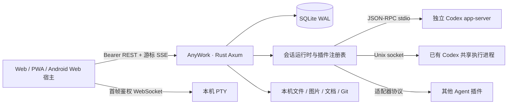

# AnyWork 系统架构

AnyWork 的 Web/PWA 直接连接运行在用户机器上的 Rust 服务，由本机 Codex app-server 执行工作。会话内容、附件、审批与文件在浏览器和该服务之间传输，不依赖 AnyWork 云端中转。Codex 自身继续使用本机既有账号和模型服务；这不表示模型推理可以离线完成。当前重点为 Web 和移动浏览器，已有 Android 内置 Web 宿主保留。

## 服务与引擎边界

Rust workspace 保留 `agent-sdk`、`agent-codex` 和 `server`。公开程序名称为 `anywork`；内部 SDK crate 名称保留兼容。前端只使用服务 API，不直接调用厂商 CLI。`AgentPlugin` 提供启动清单，外部插件通过受信任管理员安装的 JSON 清单接入，适配器负责转换厂商协议。

普通会话通过独立插件进程运行；发现的已有 Codex 会话在支持的平台通过 Unix socket 接回共享执行进程，以原 thread 继续工作。共享通知必须匹配会话 thread 后才能写入历史。未能连接原进程时返回错误，不静默另建进程或分支。

`RpcProcess` 管理请求编号、结果路由、90秒超时与断开，支持 stdio 和 socket。事件在独立循环消费，审批等待不阻塞其他响应。同一会话写操作使用异步互斥，防止多客户端重复提交 turn；每个会话保存自己的运行状态和设置。

`editing.rs` 提供受限的原生消息编辑链路，能力由 `message-edit` 声明与实时查询共同决定。它只接受未归档、空闲、持久化 paginated Codex thread 的最新回合，原生回合中必须恰好一条 userMessage、有可编辑首个 text，并能与界面消息匹配；队列正在发送时拒绝编辑。服务端读取原始 input，只替换第一个 text、清空该项 text_elements，保留其他输入及附件；首次变更前检查原 localImage/localAudio 文件仍存在。流程在同一 thread 调用 `thread/revert {beforeTurnId}`，确认后再 `turn/start`，不另建分支、不把修改当普通追加消息，也不修改工作区文件。

`user_text.rs` 区分原始输入与最终显示：先通过 `native_image_context.rs` 筛选有证据匹配的辅助文案，使用 CommonMark 与 URL 校验恢复 library 提及，通过 `native_app_input.rs` 严格验证完整 envelope。普通路径执行两次 Woe；首个有效 app-input 含 message 时执行一次。最终 `display_text` 由历史与实时事件提供；浏览器仅对同回合原首文本唯一匹配的本地回显补充正文，不修改原事件或附件。尚未完成发送者、自动化等全部特殊 dispatcher。

`rebuild` 对原始首 text 执行一次 Ooe 重建，保留 page 前缀或最后请求标记之前的上下文。GET 编辑能力返回 trim 后的显示正文；POST 重建本身不 trim，普通 UI 提交执行文档序列化及 `trim()`。Rust helper 使用 ECMAScript 空白规则。有效 app-input 和 library 元数据不再额外禁用；原生 jun 历史编辑路径不经过 YEe/rDe，直接 Ooe 并清空首项元数据。普通历史编辑使用独立 ProseMirror PZ 文档与原子引用规范化；主输入框 rich 模式及完整富文本历史模式尚未接入；保留其他输入及最新唯一用户项等边界。

`serialize_text` 对应 YEe，普通 Codex 新发送、引导及队列在 deliver 时转换 library 链接，存储 UTF-8 span 与原 Markdown placeholder；本地回显以实际 wire 首文本作身份匹配，转换前草稿另存 submitted_text。非 Codex 插件保持原文字。`rebuild_context_input` 对应 rDe，保留已验证的新 prepared context-only envelope，目前仅作独立 helper 保留，不用于历史编辑。28 个隔离原纯函数样例记录于测试 fixture；使用替代 CommonMark parser，未执行原应用或整个原模块。

`composer.rs` 将读取模型/思考强度/服务速度、修改线程设置、目标和计划模式封装为会话 composer API。目标调用 `thread/goal/get`、`set`、`clear`；用户修改使用明确动作，接口失败直接返回错误。浏览器只有在服务确认后才更新已保存设置；滑杆拖动预览与已保存值分离，按顺序合并待提交的最终选择，切换会话后忽略旧结果。服务速度由原模型目录和 `configRequirements/read` 共同约束，原生 start/resume/settings 通知是当前值来源；不另设覆盖原客户端的本地速度偏好。

## 会话界面与状态

`App.tsx` 组合连接、会话、历史/SSE、排队和预览标签。会话部分拆为 `ConversationMessage`、`Composer`、`MessageQueue`、`ModelPicker`、`GoalBanner` 与 `SplitPane`；`TurnView` 处理轮次折叠，`RequestCard` 处理审批/问答，`Workspace`、`DocumentPreview` 和 `ImagePreview` 负责产物。会话最终样式集中在 `components/conversation/conversation.css`，模型/目标/审批有各自的组件样式。

顶部使用43px区域显示当前会话的子窗口标签；会话间导航由侧栏负责。`useConversationPanels` 按服务器地址与会话ID保存文档、变更、目标、终端及选中项，替代原有跨会话标签状态。分屏在容器尺寸内钳制两侧至少160px，1px可见分隔线覆以12px交互区；鼠标、触控与键盘共用同一宽度状态，宽度也按服务器与会话共同保存到本地。720px及以下面板覆盖聊天正文，顶部保留可操作标签；聊天组件继续挂载。`useFloatingMenus` 统一管理明确标记的原生details菜单，状态菜单保留各自的portal与子菜单逻辑。详细规则见[会话子窗口与浮层契约](conversation-panels.md)与[界面设计](ui-design.md)。

`useSessionDraft` 以服务器地址与会话ID为键保存文字草稿，优先使用 `sessionStorage`，不可用时回退进程内 Map。草稿不属于服务端消息历史；未确认发送前不提交给 Agent。未上传附件不承诺跨刷新恢复。标签和分屏宽度使用本地偏好保存，关闭标签不停止执行。

`useMessageEditing` 先恢复服务端未完成编辑，再查询最新消息能力；编辑失败保留草稿，回退移除原消息后仍挂载独立恢复编辑区。`UserMessageEditor` 使用 `PromptEditor` 的真实 ProseMirror 文档，提供原附件查看、取消、发送和输入法/弹层键盘保护。`promptText` 对应普通历史 PZ 的初始化及 KX 序列化；`promptFileName` 只负责 live library 标签测量，复制保留完整标题。编辑器按 native DOM 属性恢复四种常用引用，普通纯文本粘贴保持字面内容；主 composer rich schema、引用动作菜单及所有复杂 HTML 分支尚未完成。未提交草稿仅保留在当前前端状态，服务端持久恢复的是已提交操作及其最后保存文字。

前端在待确认阶段锁定已提交文字，用同一操作核对发送结果；服务端返回异稿时保留当前草稿并提示。恢复请求通过会话版本及交互版本隔离，避免迟到的恢复响应重新打开已经结束的编辑。

`events.ts` 优先逐字使用最终 `display_text`（包括空字符串）生成 Message.text；仅缺少该字段的旧事件经 `userText.ts` 两次提取。数据库事件保留实际输入，编辑目标匹配仍依据原输入。导入历史的 text 连接不在 catalog 重复提取。`UserMessageText` 渲染 Markdown：不超过10,240个 UTF-16 单元时测量视觉行，超过阈值时强制折叠、仅渲染前10,240单元，跳过全文测量与跨代码块扩高。展开和打印使用全文；`userMessageCollapse.ts` 登记全文临时显示回调，`UserMessageActions` 通过同步全文 DOM 快照复制，再恢复折叠状态。

历史 `history_item_started_at_ms` 才是单条消息时间；索引导入的 `Event.created_at` 不作为历史消息时间。显式回合开始时间独立保存为 `turnStartedAtMs`，与从工具活动推算的工作耗时起点分开；`messageTime.ts` 用前者计算原包式日期分隔，不补造缺失时间。

引擎当前状态由独立查询和通知更新，不根据旧 `turn/started` 单独推算；无法确认时显示未知/恢复中。历史先读最近页，再按游标补齐，展开大型工具结果时才读取全文。请求取消与版本校验防止迟到响应覆盖另一会话或较新的设置。

## 持久化、恢复与审批

SQLite 使用 WAL、外键和 busy timeout。`sessions` 保存元数据，`events` 保存结构化事件与全局递增序号；删除会话级联清理事件。SSE 以 `after` 游标重放，前端按序号去重，断线后继续读取；数据库是事件来源，通知只负责唤醒。

服务重启不重放用户请求。中断的本地执行记录为 disconnected，下次显式发送时以原 `thread_id` 恢复；应用数据库与 Codex 历史均需保留。排队消息持久化，停止或重启后暂停，不在执行结果未知时自动重试。

队列编辑使用独立 `queue_edits` 表：`take` 在事务中把 pending 条目移出发送队列，保存原序号；`restore` 以原序号放回，`replace` 校验编辑后的文字/附件后以同一序号恢复。每个会话最多一个正在编辑的条目，外键随会话删除。前端保存原主草稿及附件，撤销先恢复队列再恢复主输入；等待期间的草稿/附件或会话变化会触发原条目恢复。刷新有本地编辑标记时继续编辑；标记丢失且已有新主草稿时恢复队列，避免覆盖新内容。队列轮询使用会话、请求顺序和变更版本过滤迟到结果。关闭排队仅写本地后续发送偏好，不改变现存队列的服务端状态。

`message_edits` 保存编辑的原始输入、替换输入、指纹、保留历史尾部和操作阶段（prepared、reverting、reverted、starting、completed、failed、uncertain、cancelled）。回退确认后，事件删除、history/reset 和操作更新在 SQLite 事务内完成，SSE 序号高水位保留；客户端收到重置后重读历史。变更任务独立于 HTTP 连接取消，浏览器离开不会中断原生 RPC 与日志写入之间的状态转换。服务重启把中断的 reverting/starting 标为 uncertain，不自动重放。

明确失败可在复查原生历史后重试；回退已确认时只继续发送，不重复回退。结果未知时先核对目标、保留尾部或替代输入，无法确认则继续 uncertain；未确认的发送不会盲目重发。operation_id 是本地持久操作标识，也用于新发送的 clientUserMessageId，不能据此承诺原生 turn/start 幂等。取消仅将恢复日志置为 cancelled，不恢复历史、不撤销文件、不自动恢复队列。待发送队列在编辑开始前暂停并保持暂停；未完成操作阻止普通发送。

同一 AnyWork 会话的编辑通过操作锁串行化，并在原生变更前复查消息指纹及当前尾部。原生 app-server 没有比较并交换（CAS）的编辑事务；原生桌面端、CLI 或其他外部控制者仍可能在复查和变更之间修改同一个 thread。回退与重发也不是原子事务，后者失败不会自动恢复旧历史；这些是实际边界，不应表述为跨客户端无竞争的编辑。

审批保留原始服务端 request ID，在输入框上方停靠。已解决、任务结束或连接中断后不能回应旧审批；自动批准策略只处理权限申请，开放问答仍由用户回答。卡片按自身容器宽度调整按钮，明确区分一次批准、会话缓存、permissions 的回合/会话权限和原提案规则。`validate_approval_result` 以记录的原请求校验结果与精确决定白名单，拒绝篡改提案、扩权、未知或混用字段；错误不消费待审批，成功后的重复/过期回复为409。自动与手动回复共用会话锁；自动模式只尝试一次批准/回合权限，白名单不含该动作时保留等待，不自行选择更广范围。只有唯一待处理审批且无编辑、输入法或弹层时才响应 Enter/Escape。长内容独立滚动，操作区保持可见。

## 文件与鉴权

REST 使用 Bearer，终端 WebSocket 首帧鉴权并检查来源。默认服务监听 loopback，访问令牌不放入 SSE、图片或文档 URL。Codex 账号留在本机配置中，已登录客户端共享服务端用户身份。

文本文件受工作区及符号链接真实路径检查，预览/编辑上限2 MiB。图片和二进制文档上限20 MiB；上传区域只允许当前会话自己的附件。工作区外的图片或文档必须被该会话历史明确引用，不能利用符号链接绕过边界。服务验证实际类型/文件头，Office/OpenDocument 包进一步验证包结构，响应使用禁止缓存与 nosniff。

浏览器先带鉴权读取 Blob，再创建临时 URL。PDF 交给本地 iframe 查看器内嵌并提供下载；Office/OpenDocument 仅提供下载，不上传至外部在线阅读器。换文件或卸载后取消读取并回收 Blob URL。图片同样使用鉴权 Blob，历史图片按需加载，本地待上传图片可即时预览。

Git 禁用外部 diff/textconv。PTY 使用运行服务的系统用户权限；目录校验不构成操作系统隔离，也不提供不互信的多租户边界。自动批准不改变 Codex 的工作区访问策略。

## 部署与兼容

新安装使用 `.anywork/`，仅存在旧 `.remote-agent/` 时默认复用其令牌、数据库和附件；数据库名称继续为 `remote-agent.sqlite`。配置优先级为命令行、`ANYWORK_*`、对应旧 `REMOTE_AGENT_*`、默认值，旧浏览器偏好继续迁移和读取。

Android 宿主继续使用 Java Activity 加内置 Web 资源，系统浏览器处理外链，固定 HTTPS 资源域提供页面；浏览器与宿主共用会话状态机。本轮没有新增原生手机界面，移动浏览器验证不等同于 Android 安装验收。

## 重建依据与当前范围

原 Codex 应用目录只读，REA 对指定包做静态分析；用户截图提供可见状态参考。没有原应用运行态访问，不能把本项目功能测试表述为原版运行对照。会话几何与可见控件向1:1目标收敛，回复操作已增加渲染文本复制、评价与更多菜单；评价仅保存在 AnyWork 本地数据库，并随会话导出。显式模型强度滑杆和实际服务速度已接入；缺少真实动态 preset、锁定元数据等条件分支。麦克风、朗读尚未实现；按用户本次选择，语音差距保留用于先审阅会话界面。证据、截图摘要和未知项见 [参考契约](anywork-reference-contract.md)；当前验证结果统一记录在 [验收记录](validation.md)，架构文档不保留历史测试计数。
