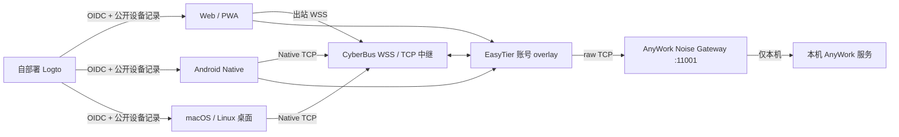

# AnyWork CyberGrid → CyberBus 迁移实施记录

2026-11-22 · 源码迁移已落地，自动化回归与真实三端验收分栏记录

基线：`9a8b0c7d9f66255a34b65dda759e2598e2e2daee`

## 结论与范围

AnyWork 已从 CyberGrid 切换到 CyberBus。当前源码不再包含 CyberGrid SDK、Web vendor、Grid 协调服务、Upstash 配置、cloudflared/tunwg/WireGuard 打包或旧远程入口。同账号多设备连接现在由以下三层组成：

1. **Logto** 负责账号、公开设备记录和 CyberBus `network:join` 授权。
2. **CyberBus + EasyTier** 提供按账号隔离的用户态设备网络，不创建系统 TUN。
3. **AnyWork Noise Gateway** 在 overlay 虚拟端口 `11001` 上继续执行原有 owner、JWT、HTTP、事件和 PTY 权限边界。

“迁移完成”在本文中只表示源码、构建和自动化测试范围。真实 macOS 桌面、实体 Android、受支持浏览器及生产 Vercel 的三端业务链尚未全部验收，不能由单元测试、Logto 实签或 WSS 连通性推断为已通过。

## 固定版本与来源

| 组件 | 固定身份 | 用途 |
| --- | --- | --- |
| CyberBus | `v0.2.0` tag，commit `a2b5be3b2c3cd8d21e6a0c5bf2b4da2040f36c11` | Rust `cyberbus-transport`、协议和凭证派生语义 |
| EasyTier | `v2.7.1`，commit `0d9c52b169dc2112687ddefcf571cd01d383193c` | Native overlay 与浏览器 WASM |
| 浏览器 bundle | `web/public/easytier-browser.js` | 5,288,976 bytes；SHA-256 `e8a1d53b2b4451de013c291bc3c53b04148d90345c81f28b8f70d569bd850469` |
| 浏览器工具链 | Node `22.16.0`、pnpm `10.15.0`、Rust `1.95`、esbuild `0.28.2` | 由 `scripts/build-easytier-browser.sh` 重建 |
| Native 构建依赖 | Protocol Buffers compiler（`protoc`） | CyberBus/EasyTier 的 `easytier-proto` 构建脚本需要；CI 由 `arduino/setup-protoc@v3` 安装 |

CyberBus 通过 Cargo Git revision 锁定，EasyTier 浏览器产物通过 provenance、文件大小和 SHA-256 锁定。`web/public/easytier-browser.PROVENANCE.json`、`web/public/easytier-browser.NOTICE.md` 和构建脚本必须与二进制一起维护。

浏览器侧要求 WebAssembly JSPI 和 `Uint8Array.fromBase64`。不支持时返回固定 `UNSUPPORTED_BROWSER`，不得退回明文代理或旧隧道。

## 目标架构



数据面只承载 AnyWork Noise 密文和必要的 overlay 元数据。Logto、CyberBus 中继和 EasyTier peer 不接收工作区业务明文，也不持有端点 Noise 私钥。

## 授权与账号所有权

### Logto 资源

当前部署：

- endpoint：`https://auth.x.aixgg.com`
- issuer：`https://auth.x.aixgg.com/oidc`
- 管理控制台：`https://logto.x.aixgg.com`（不作为客户端 issuer）
- CyberBus resource：`https://cyberbus.x.aixgg.com/api`
- product：`anywork`
- scope：`connect`、`network:join`
- Native 与 SPA 使用同一产品映射；默认 `AnyWork user` 角色拥有两个 scope。

`network:join` 允许从签发的 CyberBus credential claim 派生账号网络材料；`connect` 继续授权 AnyWork Noise Gateway。两者不能互相替代。普通 `client_credentials` token、错误 audience/client/scope、过期 token 和跨产品 claim 均拒绝。

### 每个平台一个 grant owner

- 桌面：现有 Logto JavaScript owner 完成登录、Account API token 和 CyberBus resource token 的串行刷新；交接后 Rust 成为唯一 refresh owner，JavaScript 清空 token 并停止刷新。
- Android：Kotlin Logto SDK 是唯一 grant owner，向 Rust 提供 Account API 与 resource token；Rust 不自行刷新。
- Web：官方 Logto SPA SDK 是唯一 grant owner；CyberBus 适配器只请求 access token 并验证，不复制 refresh token。

CyberBus 不接管 refresh token。桌面保存登录仍使用系统安全凭据存储；Android 使用 Keystore；浏览器授权材料只留在当前页面内存。

### 网络材料派生

签发 token 包含固定 claim：

```text
https://cyberbus.x.aixgg.com/easytier/credentials/v1
```

claim 必须精确满足 `version=1`、`product_id=anywork`、`max_devices=256`、`virtual_cidr=10.144.0.0/20`、`control_port=11000`、`config_version=1`，且 seed 为 64 位小写十六进制。客户端使用 HKDF-SHA-256 派生：

- `network-name`
- `network-secret`
- `app-handshake-psk`
- `session-binding-id/v1`

派生结果只存在于进程或页面内存，不写入 Logto、Web Storage、日志或发布产物。`credential_epoch` 变化会使旧网络材料失效；浏览器刷新发现材料变化时关闭旧网络并要求重新建立。

## 设备目录与 locator

公开安装记录仍在 Logto `customData.anywork.devices[installationId]`，只含名称、平台、Noise 公钥和 `keyVersion`。CyberBus 连接线索放在独立命名空间：

```json
{
  "anywork": {
    "cyberbus": {
      "installation-id": {
        "version": 1,
        "productId": "anywork",
        "ipv4": "10.144.0.42",
        "port": 11001,
        "keyVersion": 1,
        "issuedAt": 1760000000,
        "expiresAt": 1760000600
      }
    }
  }
}
```

约束：

- 地址必须在 `10.144.0.0/20` 内，端口必须是 `11001`；`11000` 保留给 CyberBus 控制面并拒绝。
- locator 是发现线索，不是授权。真正授权仍由 Noise 握手内的 owner、issuer、audience、client、`connect` scope 和期限校验完成。
- 桌面启用后立即发布，TTL 为 600 秒，并在到期前约 300 秒重发。
- Web 只接受产品匹配、`keyVersion` 与设备记录一致、TTL 不超过 600 秒且未过期的 locator。
- 关闭远程、退出账号、授权失效、服务身份变化或 overlay 退出时删除本安装 locator。
- 目录写入保留其他命名空间，串行化并按完整读回核对；跨设备并发仍可能产生最后写入覆盖，不宣称 CAS。
- 设备上限 32、完整 customData 上限 32 KiB。删除显示条目不等于撤销目标电脑访问。

## 数据面与安全边界

### Native overlay

桌面和 Android 通过 `cyberbus-transport` 启动 EasyTier。桌面在虚拟 `11001` 监听；Android 只作为出站客户端。EasyTier 不创建 TUN、不修改系统路由或 DNS，也不接受用户输入任意 overlay 地址。

桌面启用步骤：

1. 读取公开安装 ID，生成新的 Noise 端点密钥；
2. 启动本机 Noise Gateway 和 `connect` JWT verifier；
3. 通过唯一账号 owner 获取并验证 `network:join` token；
4. 派生网络材料并启动 EasyTier；
5. 在虚拟 `11001` 接受 raw TCP；
6. 将每个流交给与本地 WebSocket 入口相同的 Noise/HTTP/PTY/限额实现；
7. 发布 locator 并维持续期。

### Raw TCP 分帧

overlay 流与浏览器流使用同一应用帧：

```text
4-byte unsigned big-endian length | payload
```

长度范围 `1..=65535`。读取端保留跨调用半帧缓冲，短读、拆分、合并、EOF、超时和取消均按同一状态机处理；写入端串行并处理部分写入。Noise 密文帧上限同为 65,535 bytes。

### Noise 与业务权限

- 套件：`Noise_IK_25519_ChaChaPoly_SHA256`。
- 握手 prologue 绑定 `AnyWork\0remote-v1\0` 和 installation ID。
- 首帧授权 JSON 绑定 installation ID 与 `connect` access token。
- 授权租约取 JWT `exp` 与 `now + 300s` 的较小值。
- 续租必须换新 token、保持同一 subject，并推进到期时间；相同 token、过期后到达或其他 owner 均拒绝。
- HTTP 仅允许既有 `/api/` 业务路由，最大 22 MiB；PTY 最大两条；每连接最多八个并发 HTTP；全局最多四条认证/握手连接。
- 不支持明文回退，不代理 `/api/service/*`、本机 cookie 交接或任意主机。

## 源码改动

| 区域 | 结果 |
| --- | --- |
| `crates/cyberbus` | 新增 JWT/JWKS 验签、credential claim 校验、HKDF 派生、locator 校验和 EasyTier no-TUN overlay |
| `crates/desktop` | 删除 Grid SDK/发布路径和 cloudflared 模块；现有 Logto owner 获取 resource token，启动 Gateway + overlay，发布 locator |
| `crates/mobile` | 删除 `grid.rs` 和旧 TLS 隧道；Kotlin 继续独占 grant，Rust 验证同一 token 并建立 overlay |
| `crates/remote` | WebSocket 与 raw TCP 共用 Noise、HTTP、事件、PTY、授权续租和限额；增加 4 字节大端分帧 |
| `web` | 新增 `cyberbus.ts`、`overlayChannel.ts`；Logto 验签、HKDF、EasyTier 动态加载、raw 分帧和 Noise 复用 |
| `desktop/ui` | 移除线路、Grid 状态和公网 URL；只显示账号、设备身份和远程开关 |
| 构建/部署 | 删除 Grid vendor、补丁、Upstash/Redis 脚本、cloudflared/tunwg/WireGuard 下载与打包、旧 Vercel rewrite |

旧 `integrations/cybergrid`、`web/src/vendor/cybergrid`、桌面 cloudflared 模块、Android Grid/TLS 模块和对应测试已删除。`Cargo.lock` 不再解析 CyberGrid。

## Logto 与中继部署证据

### Logto

已在 SSH 主机 `cath-w` 的 `/home/water/work/codex-work/logto` 完成：

- 修改前备份到仓库外 `.cyberbus-anywork-20261122T045301434493Z/`，权限 `0700`。
- 为 CyberBus resource 增加 `connect`、`network:join`。
- 为 `AnyWork user` 默认角色绑定两个 scope。
- `ET_PRODUCTS_JSON` 增加 `anywork` 产品，Native 列表包含 `AnyWork Desktop`，browser 列表包含 `AnyWork Web`，保留 `cyberbus`、`cybernote`。
- `AnyWork Web` SPA 登记生产、loopback 和自定义域名 `/app/callback`。
- 删除旧 AnyWork CyberGrid resource 及旧 `connect` 绑定。
- `blockIssuanceOnError=true`，credential epoch 为 `2`。

真实 Native 与 SPA PKCE 登录已通过，两个 client 对同一 subject 获得相同 `product_id` 和 credential claim；refresh 后 claim 保持一致。token、密码、管理凭据和 root key 未进入仓库、日志或本文；证据保存在仓库外 `0700` 目录。

### WSS 中继

SSH 主机 `cath-w` 的 `/home/water/work/codex-work/cyberbus/transport-relay` 已运行：

- listener：`tcp://0.0.0.0:11010`、`udp://0.0.0.0:11010`、`ws://127.0.0.1:11011`
- Caddy：`https://cyberbus.x.aixgg.com` 反代 `127.0.0.1:11011`
- Let’s Encrypt 证书 CN 为 `cyberbus.x.aixgg.com`，当前有效期至 2027-02-20
- WebSocket Upgrade 实测返回 `101 Switching Protocols`
- EasyTier 临时节点跨 TCP `11010` 与公开 WSS 完成互通

中继只转发 EasyTier 密文，不执行 AnyWork JWT 或业务授权。

## 验证结果

### 已通过的自动化与基础设施验证

| 范围 | 结果 |
| --- | --- |
| `cargo test -p anywork-cyberbus` | 5 passed |
| `cargo test -p anywork-remote` | 19 passed |
| `cargo test -p anywork-desktop` | 58 passed，1 ignored |
| `cargo test -p anywork-mobile` | 42 passed |
| `cargo test --workspace` | 全部通过；仅保留显式 ignored 的私有/真实环境用例 |
| `cargo clippy --workspace --all-targets -- -D warnings` | 通过 |
| `cargo fmt --all -- --check` | 通过 |
| `cargo build` | 通过 |
| Web Vitest | 45 files / 414 tests passed |
| Web private browser state | 7 tests passed |
| Web 生产构建 / PWA | 通过；`easytier-browser.js` 5,288,976 bytes，SHA-256 与 provenance 一致 |
| 桌面 UI 构建 | 通过 |
| 前端配置检查 | `python3 scripts/cloud/test_frontend.py` 7 passed |
| 桌面端到端 | Playwright 681 passed，1 skipped；包含 CyberBus 远程入口与更新器流程 |
| 移动端到端 | Playwright 48 passed |
| 完整检查 | `scripts/check.sh` 通过，覆盖 Rust、Web、桌面 UI、移动端、桌面/移动端 e2e 和更新器检查 |
| 格式与归档 | `npm run format:check`、`git diff --check`、`scripts/source-archive-test.py` 7 passed、`scripts/corresponding-source-test.py` 2 passed |
| Android debug APK | `scripts/build-android.sh` 通过；Lint、Kotlin/Robolectric、16 KiB alignment、签名和 APK 内容校验通过；包含最新 CyberBus/LGPL notices |
| 对应源码归档 | `artifacts/corresponding-source.tar.gz` 15,003,680 bytes，2108 entries，权限 `0644`；SHA-256 `80c5b1d113ff306c5a7189bfb896bc6464127cc4ea8a4786db633776a53658c7` |
| Logto 实签 | Native + SPA PKCE、双 scope、相同产品 claim、refresh 一致性通过 |
| WSS | TLS、`101` Upgrade、EasyTier 跨 TCP/WSS 字节互通通过 |

首次完整检查因本机缺少 Playwright Chromium 停在浏览器检查；安装匹配版本后已完整重跑并通过。PWA 的 `/corresponding-source` 排除也已从生成的 `web/dist/sw.js` 读回确认。未实际执行的真实设备、生产部署和跨网络场景仍按下方门槛处理，不得用自动化结果替代。

### 尚未完成的真实产品验收

- macOS 桌面真实 UI：登录、开启远程、locator 发布、Noise Gateway、关闭/退出清理。
- Android APK：真实账号登录、Keystore 恢复、设备目录、公钥确认、连接和业务操作。
- Chrome/Edge：真实 JSPI + EasyTier + 公网 WSS + 桌面工作区。
- 三端同时对同一桌面执行会话、历史、文件、PTY 和授权续租。
- 浏览器休眠/唤醒、Wi-Fi/蜂窝切换、限制性网络、长时连接与中继故障恢复。
- 生产 Vercel 前端重新部署与 GitHub repository vars 读回。

这些是上线门槛，不是“待补测试”的装饰项。未通过前不得宣传三端完整远程工作区已验收。

## 上线与回滚

### 上线顺序

1. 完成 Rust、Web、桌面 UI、Android 构建和本仓库完整检查。
2. 在受控账号验证桌面、Android、浏览器三端对同一安装的 locator、公钥和业务链。
3. 确认生产 `VITE_LOGTO_*`、`VITE_CYBERBUS_*` repository vars 与公开默认值一致，重新生成 CSP 并部署 Vercel。
4. 以少量受邀设备启用，观察登录成功率、locator 新鲜度、连接建立耗时、授权续租和中继错误。
5. 达到约定阈值后再扩大范围；出现跨账号连接、凭据泄露、错误授权或业务重复提交时立即停止。

### 回滚

- 源码回滚使用基线或独立修复版本整体回退；不把 CyberGrid 代码重新拼回当前目录。
- Logto 使用仓库外备份目录恢复资源、scope、角色、产品映射和回调；恢复前核对当前 epoch、root key 和其他产品签发。
- 中继可回退到旧监听或关闭公网站点；这不会恢复 AnyWork 的业务明文可见性。
- 客户端回滚必须同时考虑保存的登录命名空间、locator 字段和端点公钥。不得重放未知写入结果。
- 旧 CyberGrid 服务和历史客户端是否继续可用取决于独立保留的部署；当前仓库不再维护其在线路径。

## 许可证与对应源码

CyberBus workspace 根声明 MIT OR Apache-2.0，但 `cyberbus-transport` 为 `LGPL-3.0-or-later`，vendored EasyTier 为 LGPL-3.0。AnyWork 静态链接该 transport，因此：

- 不得把完整 SDK 描述为仅 MIT/Apache-2.0；
- 必须随发行物保留 MIT、Apache-2.0、LGPL-3.0 和 GPL-3.0 文本；
- 必须提供固定 CyberBus/EasyTier 对应源码、构建命令、修改说明和重链接方式；
- 不得禁止为调试 LGPL 部分修改而进行逆向工程；
- 浏览器 `easytier-browser.js` 的 WASM 与 Native transport 分别记录来源和构建方式。

具体发行材料：

- `licenses/cyberbus-LGPL-COMPLIANCE.md` 记录组件、许可证、重建和重链接义务；
- `licenses/cyberbus-MIT.txt`、`licenses/cyberbus-Apache-2.0.txt`、`licenses/cyberbus-transport-LGPL-3.0.txt`、`licenses/GPL-3.0.txt`、`licenses/easytier-LGPL-3.0.txt` 和 `licenses/easytier-js-Apache-2.0.txt` 提供完整文本；
- `scripts/corresponding-source.py` 从固定 Git revision 生成 `artifacts/corresponding-source.tar.gz` 和 SHA-256 sidecar；包内含 CyberBus `packaging/NOTICE.md`、`packaging/RELINK.md`、vendored EasyTier、Cargo lock 和完整 EasyTier 源码；
- AnyWork 应用源码继续由 `scripts/source-archive.py` 生成 `artifacts/anywork-source.tar.gz`；
- 发布包、原生 updater、Vercel 静态站点和自托管服务分别通过 `artifacts/`、`/corresponding-source` 和 `/source` 提供两份源码；
- 从 v0.1.49 起，GitHub Release 直接提供 `corresponding-source.tar.gz` 与 `.sha256`，共 25 项资产、24 条 `SHA256SUMS` 记录；除 `SHA256SUMS` 自身外每个资产均有校验值。

许可证、`NOTICE`、`THIRD_PARTY_NOTICES.md` 和 Web 发行说明必须与本文和实际锁文件一致。上游 `packaging/NOTICE.md` 与 `packaging/RELINK.md` 的约束纳入发行检查。不得把 `cyberbus-transport` 或完整 native transport 描述为仅 MIT/Apache-2.0。

## 运维检查

- Logto：issuer discovery、JWKS、resource/scope/role、产品 client 类型、回调、epoch 和 `blockIssuanceOnError`。
- 中继：TCP/UDP `11010`、loopback WSS、Caddy 证书续期、WebSocket `101` 和容量告警。
- 桌面：本机服务就绪、overlay 地址在池内、`11001` 监听、locator 续期和关闭清理。
- Web：JSPI、`Uint8Array.fromBase64`、CSP `wasm-unsafe-eval`、同源 bundle、WSS `connect-src` 和 PWA 缓存。
- Android：Native client、Keystore 恢复、overlay TCP、公钥确认和前台恢复。

诊断只输出固定错误码，不记录 token、网络秘密、授权 URL、响应体或用户内容。
