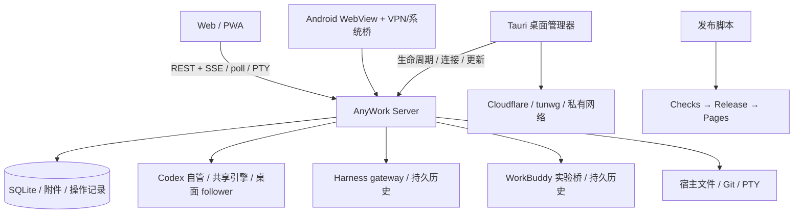

# AnyWork 全项目改进评审稿

> 日期：2026-11-07 · 文档状态：待专家评审，建议尚未批准为实施承诺。
> 源码基线：`db7f2ab`（应用版本 0.1.12，包含刚完成的一键发布脚本）。
> 目的：让产品、架构、安全、Agent 集成、客户端及测试专家基于同一份事实讨论后续改进。
> 本次复核：2026-11-07，主线 `00b56db`；相对上述基线仅有文档/计划变更，产品源码未变。独立工作树中的候选修复尚未合入，状态见第 16 节；不能据候选测试结果关闭本文议题。

阅读建议：产品负责人先读第 1、3、11、12 节；技术评审从第 4、5 节进入对应议题；测试与交付负责人重点阅读第 13、16、17 节。[当前支持矩阵](support-matrix.md)维护能力事实，[实施跟踪](plan/improvement-progress.md)维护后续进度，本文保留评审时的证据与问题定义。

## 1. 核心判断

AnyWork 已具备可继续演进的基础：Rust 本地服务、持久事件日志、原生执行所有权保护、多 Agent 历史接入、Web 会话缓存、桌面连接管理、Android 宿主、多平台发行与可恢复发布流程均已有实现。下一步不建议全面重写；应先补齐关键一致性边界与真实使用验收，再按状态所有权逐步拆分模块。

项目当前最大的差距是：“能展示和操作许多功能”与“在不同原生版本、网络、设备和进程生命周期下持续可靠地协作”之间，仍有尚未闭环的环节。尤其不能将被动历史读取、模拟协议测试、手机尺寸浏览器测试和真实原生写入验收视为同一种证据。

建议优先评审以下六组工作：

1. **作用域与数据一致性**：全局事件过滤、发送结果不确定时的协调、持久化失败处理、文件并发保存。
2. **原生协作可信度**：WorkBuddy 实机写入、Codex 不同连接拓扑的能力边界、队列与目标的状态归属。
3. **离开桌面后的可用性**：Android 真机、后台通知、桌面退出/后台运行、电脑休眠和网络切换。
4. **升级与恢复**：慢网络下载续传、数据库迁移/备份/恢复、更新与原生任务之间的生命周期。
5. **交付保障**：所有发版入口执行统一 CI 门禁、Docker 构建修正、平台安装与签名验证。
6. **工程可持续性**：兼容矩阵、诊断与指标、资源预算、模块拆分、文档同步和视觉/无障碍基线。

本轮没有发现足以据当前证据判定为 P0 的问题。这不构成安全认证或“没有漏洞”的声明。下文列出 **30 项改进议题**，每项均标注证据性质与验收方向。

## 2. 调研方法、范围与证据等级

### 2.1 本次做了什么

- 检查项目说明、架构、协议、各 Agent 集成契约、近期独立审查与验收记录。
- 检查 `crates/server`、`agent-sdk`、`agent-codex`、`crates/desktop`、`web`、`desktop/ui`、`android`、构建/发布脚本和 GitHub Actions。
- 将后端、Agent 集成、客户端/发行分别交由独立审查，再由本文合并并复核关键源码路径。
- 核对已有防护和已修复事项，避免将历史问题重新当作未修复缺陷。

评审稿 `cc6769c` 已由后端与客户端两个独立方向复核，未发现阻塞性事实问题；检查确认 30 个议题 ID 连续且唯一，68 个项目内链接目标及行号/标题锚点有效。此处是文档事实复核，不能替代后续专家对方案、优先级和风险接受的批准。

### 2.2 本次没有做什么

本轮是源码与验收证据分析，未重跑完整测试套件、渗透测试、性能压测或真实设备实验；未读取私有账号/令牌/会话、修改原生应用、调用真实任务、部署服务或发布新版本。文中引用的实机与 CI 结果来自注明的既有验收记录。未检查 GitHub 网页中的分支保护、组织权限等仓库外配置。

| 标记 | 含义 | 解释限制 |
| --- | --- | --- |
| **A：源码确认** | 可从当前实现确定的数据流、行为或缺少的控制 | 不自动代表本轮已经复现生产事故；静态结论会明确说明 |
| **B：验收缺口** | 已有文档明确未覆盖，或测试入口只覆盖较低层级 | “未验收”不等于“功能一定失败” |
| **C：设计选择** | 当前行为可合理解释，但与目标存在取舍 | 需要专家决策，不应直接按 bug 修改 |
| **D：容量假设** | 存在扩展风险，需要基准数据才能判断投入 | 不声称当前已经慢、泄漏或 OOM |

优先级定义：**P0** 为已证实的严重安全/数据事故阻断；**P1** 为扩大对应功能使用前应解决或明确限制的核心问题；**P2** 为下一阶段质量与可维护性改进；**P3** 为产品方向与可选扩展。同一议题的实施顺序仍需结合目标用户和平台决定，不等于所有 P1 都阻断个人试用。

## 3. 当前能力与成熟度

下表是本文基线判断，后续应由 I07/I25 建议的统一支持矩阵取代，避免再形成独立事实来源。

| 能力 | 当前基础 | 仍需补齐的证据/边界 |
| --- | --- | --- |
| 自管 Codex / 共享引擎 | 已有实际隔离引擎联调、会话/流式/审批/目标等实现 | 已验证版本之外的兼容策略、长期双端并发与故障组合 |
| 已运行 Codex 桌面协作 | 已有同 thread、同回合 steer 的真实验收；保留原进程 | follower 目标只读/暂停；完整审批、下一轮、附件/动态工具实机矩阵未闭环；Windows 不支持相同热接入路径 |
| 无共享入口的独立进程 | 可发现/读取支持格式的历史；不悄悄另开竞争引擎 | 不能承诺任意纯 stdio 进程无损热接管，应提供受支持启动路径 |
| DeepSeek Harness | 已有共享 HTTP gateway、被动历史及 pinned upstream 隔离验收 | 限定上游版本；目标/计划/分叉/编辑等能力有边界；独立 TUI 无入口不受控 |
| WorkBuddy | 已实现被动历史、可见正文投影、实验共享桥接与夹具流式验证；真实三轮历史只读核对通过 | 真实新建/发送/取消/审批/断线协作写入仍未完整验收；不能由历史修复推导全部写能力完成 |
| Web/PWA | 历史分页/缓存、事件复用、富文本、工具/子 Agent、审批、文件/终端已有实现 | 1:1 全状态视觉验收、其他浏览器、极长会话、无障碍与容量基线 |
| Rust/Tauri 桌面 | 服务、路由、设备活动、工具下载及签名更新已有实现 | 后台/退出语义、开机/休眠、平台签名、完整安装升级与恢复矩阵 |
| Android | 原生 Java WebView 宿主、连接配置、文件分享、Keystore 配置保护、可选 WireGuard | 真机安装、WebView/VPN 生命周期、Doze/杀进程、后台提醒和升级覆盖 |
| 远程连接 | LAN、自有 HTTPS、Cloudflare 临时/固定隧道、自有 tunwg/私有 WireGuard 路径 | 网络故障诊断、切换/恢复实测、凭据撤销模型、不同 TLS 终止点说明 |
| 发布与网站 | 五种桌面目标、APK、Web/源码、20 个资产；新脚本串联精确 SHA Checks、Release、Pages 和轻量核验 | 其他发版入口的同等门禁、安装级验收、供应链证明；元数据核验不等于安装验收 |

现有方案值得保留：默认 loopback 与令牌鉴权、恒时比较、文件真实路径边界、会话附件隔离、终端先鉴权、SQLite WAL/重放唯一键、队列/编辑 uncertain 状态、thread 身份过滤、连接失败不另建引擎、未知协议停止写入、更新签名与版本绑定、发布状态原子恢复。这些是改进基础，不应在重构中被削弱。

## 4. 架构与责任边界



必须保留的五条不变量：

1. 一个原生会话的执行所有者必须可确认；不能因远程连接失败创建另一个引擎。
2. 原生已接受但响应丢失时，先协调结果；无法证明安全就显示 uncertain，不盲目重发。
3. 列表、历史、文件、控制和全局事件必须采用一致的可见范围。
4. 浏览器关闭不应被误解释成任务结束；管理器退出、服务停止、引擎停止是不同操作。
5. 用户可见能力必须同时考虑 Agent、连接拓扑、上游版本、当前状态与验收等级。

## 5. 改进总表

“责任”表示建议负责的专业方向，不指派具体人员；全部事项当前均为**待评审**。

| ID | 议题 | 优先级 | 证据 | 建议责任 |
| --- | --- | --- | --- | --- |
| I01 | 全局事件与会话作用域一致 | P1 | A | 后端/安全 |
| I02 | 普通发送的稳定操作 ID 与不确定结果协调 | P1 | A | 后端/Agent/Web |
| I03 | 持久化失败的显式降级与恢复 | P1 | A | 后端/运维 |
| I04 | 文件并发保存冲突与原子写入 | P1 | A | 后端/Web |
| I05 | 数据库迁移、完整备份和保留策略 | P1 | A/B | 数据/桌面 |
| I06 | 通道、RPC、同步 IO 和导出资源预算 | P2 | A/D | 后端/性能 |
| I07 | 结构化能力、就绪状态及错误协议 | P1 | A/C | 架构/所有客户端 |
| I08 | 原生协议兼容与版本支持生命周期 | P1 | A/B | Agent 集成 |
| I09 | WorkBuddy 实机写入验收 | P1 | B | Agent/测试 |
| I10 | 双端队列、目标与编辑的状态所有权 | P1 | A/B/C | Agent/产品 |
| I11 | 多 owner 消歧与原生并发操作边界 | P2 | A/C | Agent/架构 |
| I12 | 被动历史和实时事件的来源与演进 | P2 | A/B | Agent/数据 |
| I13 | 连接探测、传输选择及故障诊断 | P2 | A/B | 网络/桌面/Web |
| I14 | 管理器退出、后台运行和系统生命周期 | P1 | A/C | 桌面/产品 |
| I15 | Android 真机与 VPN/WebView 生命周期 | P1 | B | Android/测试 |
| I16 | 后台通知与隐私/连通性取舍 | P1 | A/B/C | 移动/产品/安全 |
| I17 | 自动更新慢网络、续传与恢复验收 | P1 | A/B | 桌面/发布 |
| I18 | 平台签名与上游已知依赖风险 | P2 | A/B | 发布/安全 |
| I19 | 每设备授权、撤销和链路信任模型 | P1（公网场景） | A/C | 安全/产品 |
| I20 | 所有发布入口统一 CI 门禁 | P1 | A | 发布/测试 |
| I21 | 供应链、密钥恢复与发行证明 | P2 | A/B | 发布/安全 |
| I22 | Docker 可构建性与部署矩阵 | P1（容器场景） | A/B | 部署/测试 |
| I23 | 模块按状态所有权拆分 | P2 | A/C | 架构/前后端 |
| I24 | 长会话、多活动会话和目录性能 | P2 | A/D | Web/性能/Agent |
| I25 | 文档、支持矩阵和版本事实同步 | P1 | A | 产品/文档/集成 |
| I26 | UI 对照、无障碍与跨浏览器 | P2 | B/C | 设计/Web/测试 |
| I27 | 首次连接、诊断与恢复引导 | P2 | A/C | 产品/桌面/移动 |
| I28 | 可观测性、诊断包和运行手册 | P2 | A/B | 全栈/运维 |
| I29 | 分层测试、平台验收和故障注入 | P2 | A/B | 测试/所有模块 |
| I30 | 搜索、多机器、语音等扩展取舍 | P3 | C | 产品/架构 |

## 6. 数据正确性与服务端可靠性

### I01 · 全局事件接口统一作用域

**事实（A）**：会话列表按 `session_in_scope` 过滤，单会话入口也检查范围，但全局 `/api/events`、`/api/events/poll` 直接读取全部 Store 事件。[api.rs:119](../crates/server/src/api.rs#L119)、[api.rs:784](../crates/server/src/api.rs#L784)、[store.rs:776](../crates/server/src/store.rs#L776)。

**触发与影响**：同一数据目录曾以 all 范围导入多个项目，后来收窄为 workspace，持有效令牌的客户端仍可通过全局事件游标取得列表和单会话入口不再允许的历史 payload。这是当前产品作用域一致性问题；并非无令牌访问，也不应称为已实现多租户隔离后的越权。

**建议**：统一可见性判定并同时应用于 SSE/poll。返回“扫描到的高水位”与可见事件，整页都被过滤时仍推进；兼顾 Web poll 当前按收到事件更新游标的行为，不能只在 SQL 后简单过滤。

**验收**：准备两个 cwd、三种 Agent 的事件；all→workspace 重启后列表/单会话/全局流一致；连续至少 500 条不可见事件之后仍能读取下一条可见事件；无 payload 泄漏、卡游标或无限重扫。

### I02 · 普通发送引入持久操作身份

**事实（A）**：[Message](../crates/server/src/api.rs#L292) 没有客户端稳定操作 ID；composer 的 `clientUserMessageId` 在服务端每次提交时生成 UUID（[api.rs:485](../crates/server/src/api.rs#L485)），用途是元数据关联，不是网络重试去重。RPC 请求号也只存在于连接内。

**风险边界**：原生已执行但 HTTP 响应丢失时，客户端缺少统一结果查询/去重契约。本轮没有复现重复执行，不能将风险写成已发生事故。现有队列与编辑的 uncertain 设计应保留并复用。

**建议**：客户端预先生成 `operation_id`；服务端在投递前持久化 ID、会话、请求摘要和阶段，返回可查询状态。相同 ID/相同摘要返回原结果；相同 ID/不同内容拒绝。原生不提供幂等键时，通过 thread/turn/消息身份协调，不能承诺端到端 exactly-once。

**验收**：发送前断线、原生接受后丢响应、服务重启、两个设备重复同 ID、不同正文冒用同 ID；已知已接受不再次投递，无法确认则返回 uncertain。草稿、附件、目标启用的分阶段结果可分别解释。

### I03 · 写盘失败不能只留日志

**事实（A）**：[runtime.rs:40](../crates/server/src/runtime.rs#L40) 的 `emit` 返回 `()`，事件持久化失败仅记录错误（同文件第 67 行），原生事件消费继续。磁盘满或写入错误时，执行可能继续而可恢复记录中断。

**建议**：建立 storage-degraded 状态；可拒绝的新命令必须先完成操作记录；已接受任务不随意杀停，但显示状态未知/记录异常，并在恢复后按原生身份补齐。让健康/就绪诊断、桌面状态与 UI 感知故障，避免把“native 接受”和“本地记录成功”混为一谈。

**验收**：注入 `SQLITE_FULL`、锁等待、只读目录及失败恢复；不能继续报告已可靠记录，也不能通过重发补偿。审批、完成和用户消息的丢失均能被检测和协调。

### I04 · 文件编辑增加版本条件与原子替换

**事实（A）**：[files.rs:63](../crates/server/src/files.rs#L63) 的写请求只有 path/content，第 90 行直接 `std::fs::write`，没有预期内容 hash。Web 读取后若 Agent 修改了同文件，保存旧内容可覆盖新结果；进程中断存在部分写入风险。

**建议**：读取返回版本/hash，保存要求 `If-Match` 或 expected hash；冲突返回可比较的新版本和 409。采用同目录临时写入与原子替换，评审权限、换行、文件模式和平台差异；创建新文件也要有明确条件。

**验收**：模拟桌面修改与 Web 保存交错，旧版本不得覆盖；中断、磁盘满不留下半文件；编辑器保留草稿并允许比较、另存或明确覆盖。该项应早于扩大“桌面/远程同时编辑”宣传。

### I05 · 数据生命周期、迁移和可恢复备份

**事实（A/B）**：Store 启动执行一段 `CREATE IF NOT EXISTS` 和状态修复，并每次设置 `user_version=1`（[store.rs:56](../crates/server/src/store.rs#L56)）。[会话导出](../crates/server/src/api.rs#L849) 仅含 session/events/feedback，不是包含附件、队列、编辑操作、composer 元数据与配置的完整备份。现有部署记录有人工私有备份，不等于产品化恢复流程。

**建议**：版本化事务迁移，打开未来 schema 时在变更前拒绝；升级前一致快照与恢复演练。明确 AnyWork 缓存、原生历史、凭据和附件各自权威来源；使用 SQLite 一致备份机制或停写流程，不能直接复制正在写入的主库并忽略 WAL。确定事件压缩/保留和孤立附件回收规则，活动/uncertain 操作不得提前清理。

**验收**：所有受支持旧 schema 升级、迁移中断/磁盘满、未知新 schema 拒绝、干净安装恢复；附件和原 thread 映射完整；恢复后队列保持安全暂停，绝不自动重放任务。应用回滚与数据库回滚分别设计，不能假定替换旧程序即可降级。

### I06 · 给事件、IO 与导出设置资源预算

**事实（A/D）**：SDK 有多个无界通道与未显式限制字节数的逐行 JSON 读取（[agent-sdk/lib.rs:39](../crates/agent-sdk/src/lib.rs#L39)、[第 131 行](../crates/agent-sdk/src/lib.rs#L131)）；完整导出先聚合全部事件为 Vec。Store 是同步 `Mutex<Connection>`，busy timeout 为 5 秒，直接被 async handler 调用。没有本轮 OOM 或延迟实测。

**建议**：先定义单帧、队列字节、并发 RPC、连接数与导出预算；重 IO 转入受控阻塞执行器/DB actor。导出使用流式 NDJSON 或归档。背压必须保留审批、结束、断线等控制事件，不能直接“有界队列满就丢最旧”，也不能让事件积压阻断 RPC 响应而产生死锁。

**验收**：高吞吐工具+慢消费者、巨大单帧、长历史导出并发、慢盘；记录峰值内存、控制事件延迟和停止耗时。优先以证据改善现有 SQLite，不预设切换数据库。

## 7. Agent 协作与兼容

### I07 · 能力、就绪状态与错误协议统一

**事实（A/C）**：插件静态能力是 `Vec<String>`（[agent-sdk/lib.rs:30](../crates/agent-sdk/src/lib.rs#L30)）；通用 HTTP 错误仍按英文 `not found/outside/busy/pending` 子串决定状态码，其余为 400（[main.rs:232](../crates/server/src/main.rs#L232)）。部分原生入口已有专门保护，不能被统一化时丢失。

**建议**：区分 installed/enabled/configured/reachable/readable/writable/tested；能力按 Agent+拓扑+版本+当前状态得出，并附不可用原因。错误采用稳定 code/status/retryable/delivery_state/correlation_id，原生详情受控保留。先用于关键命令，再迁移其他入口，保留旧客户端兼容。

**验收**：未安装、未登录、历史可读但不能写、协议不兼容、忙碌、投递未知、内部写盘故障均可区分；相同错误跨语言/Agent 稳定；模型/目标/编辑等按钮与服务端实际能力一致。

### I08 · 建立上游版本支持生命周期

**事实（A/B）**：WorkBuddy descriptor 限定 5.9.3（[workbuddy.rs:89](../crates/server/src/workbuddy.rs#L89)），Codex desktop stream 限定 v11（[desktop.rs:179](../crates/server/src/desktop.rs#L179)）；Harness 文档固定 0.2.2-rc.1，但没有统一的版本/能力握手投影。严格拒绝未知版本本身是防护，不应为兼容“自动放宽”。

**建议**：维护版本、协议/schema 指纹、历史格式、支持操作、验证日期及退役政策；提供可运行的诊断命令。官方协议优先，私有入口明确实验/版本约束；新增上游 canary 验证，失败不阻断已验证 pinned 版本的稳定使用。

**验收**：旧 descriptor、上游升级、未知方法/字段、错误 profile、格式未来版本均有确定结果；安全历史读取与未确认写能力可分别降级。每次声明支持新版本都要附真实 upstream 或原生验收，不能只更新版本字符串。

### I09 · WorkBuddy 写入完成实机闭环

**事实（B）**：[当前契约](workbuddy-integration.md)及[最新修复验收](workbuddy-transcript-updates.md#verification-and-limits)仍区分确定性 preload 夹具与真实只读核对。真实三轮历史已可读，正文清洗和稳定 key 更新已修复；不能再次列为“历史完全不可用”。原生写入/审批/取消等仍缺完整验收。

**建议**：建立隔离的、正常初始化的专用原生环境，逐项验收创建、发送、流式、附件、工具、权限、取消、重连与桌面继续执行；保存版本、源码 SHA、conversation/turn/request 身份及结果摘要，禁止使用私人任务作测试。

**验收**：Web 与桌面看到同一原生会话与结果，权限两端一致解决，断线无重复/无悄悄换会话，原桌面不被重启。写链路通过前，UI 与下载说明持续标为实验，并明确“历史可读”和“共享执行可用”的不同。

### I10 · 队列、目标和编辑归属必须清晰

**事实（A/B/C）**：排队写入 AnyWork Store（[api.rs:335](../crates/server/src/api.rs#L335)），[桌面协作说明](desktop-collaboration.md)承认原生队列未迁移。Codex follower 对目标只支持读取/暂停（[composer.rs:16](../crates/server/src/composer.rs#L16)）。受限消息编辑也无法提供原生跨客户端 CAS。

**建议**：先决定按拓扑采用原生队列还是明确“仅 AnyWork 排队”；一条消息只能有一个调度所有者。记录 native queue ID 与 operation ID，定义目标创建“消息已发送/目标启用失败”的部分成功。原生缺 CAS 的编辑/取消必须诚实说明边界，不能通过前端乐观更新掩盖。

**验收**：任一端编辑/删除/暂停，另一端正确刷新；不支持的拓扑明确禁用或注明局部范围；并发 start、断线重启不重复发送；目标恢复/清除和消息编辑失败均保留可解释的状态及草稿。不要把 follower 目标恢复直接映射成一个其不支持的 RPC。

### I11 · 多 owner 消歧与原生竞态

**事实（A/C）**：[control.rs:95](../crates/server/src/control.rs#L95) 遍历注册 socket，遇到首个 loaded host 即返回，未收集全部候选以确认唯一性；设计文档要求歧义报错。本轮没有生产双 owner 事故证据。WorkBuddy cancel 复查后仍只按 conversation ID 操作，原生不提供 expected-turn 原子条件（[workbuddy.rs:1441](../crates/server/src/workbuddy.rs#L1441)）。

**建议与验收**：按 thread/home/cwd/原实例身份收集并消歧，重复入口可合并，多个真实候选则不发送。测试两个 loaded、一个超时、同实例多入口、校验后换 turn；缺原生原子能力时，由专家决定允许范围与 UI 提示，保留临近发送复核及不重放原则。

### I12 · 历史来源与实时事件形成版本化契约

**事实（A/B）**：当前已重视原生稳定 key、被动/实时顺序、visible text 与原输入分离，以及严格历史格式校验。最近 WorkBuddy 问题说明“模型输入上下文”与“用户可见消息”不能共用模糊解码。相关依据：[WorkBuddy 投影](workbuddy-transcript-updates.md)、[Harness 历史](harness-persisted-history.md)、[重放一致性](message-replay-consistency.md)。

**建议**：在现有字段上形成版本化 provenance：来源 host/profile、native session/turn/item、源游标/代际、投影版本、raw/visible 分离；未知原生事件保留可诊断原文，不用猜测标题或文本去重。迁移投影时明确哪些缓存可以重建，哪些用户本地元数据必须保留。

**验收**：损坏尾行、分支、压缩格式、同 key 更正、live 覆盖 passive、跨页更新、原生未知字段；无重复、无误删；重投影不能重发工作或暴露 system context。

## 8. 网络、桌面和移动生命周期

### I13 · 从“正在恢复”升级为分层诊断

**事实（A/B）**：已有路由恢复和身份探测；Web 对 `trycloudflare.com` 使用 poll 代替 SSE（[api.ts:90](../web/src/api.ts#L90)），传输策略与域名绑定。匿名 URL 只在原进程生命周期内尽量保留，重建后无法保证原址，现有说明是正确边界。

**建议**：保留已知传输约束，增加有界能力探测和可配置 fallback，不仅按域名猜测。状态拆为本地服务认证、连接器进程、DNS/TLS、远端 origin 身份和 API 事件新鲜度；错误给出检查项。恢复采用单飞、退避/抖动和明确时间预算，保留可用路由，不反复重建所有通道。

**验收**：DNS/证书/代理失败、SSE 缓冲、poll、UDP 受限、网络切换、休眠、临时隧道进程存活/退出；恢复到同一服务身份和原会话，无重复命令。地址稳定性与连通性分别报告。

### I14 · 明确关闭窗口、后台运行、退出和停服

**事实（A/C）**：[main.rs:151](../crates/desktop/src/main.rs#L151) 的退出请求会调用 manager shutdown；[manager.rs:1330](../crates/desktop/src/manager.rs#L1330) cleanup 会停止自管服务/路由。现有所有权保护避免误杀独立服务，但管理器本身没有完整的常驻后台/开机启动路径。

**建议**：专家选择“关闭窗口留后台”还是“关闭即停服”，显式区分退出应用和停止服务；需要时引入托盘/菜单栏或独立用户级后台服务。平台分别设计自启、崩溃恢复和日志；退出管理器不等同停止外部原生 Agent。

**验收**：关闭窗口、显式退出、登出、重启、休眠/唤醒、应用更新及进程崩溃后，服务/隧道行为符合选择；远程端收到可解释状态。任何自动恢复都不能自动重发原工作。

### I15 · Android 按真实 WebView/VPN 验收

**事实（B）**：[Playwright](../playwright.config.ts#L18) 的 android-web 是 Chromium Pixel 7 模拟，不是 Android App。CI 有 assemble/lint/unit，但没有设备级生命周期矩阵。`MainActivity` 读取保存配置不等于重建 WireGuard；连接建立主要位于显式连接流程。

**建议**：模拟器先建立安装/桥接/升级基线，真机覆盖至少两类系统/WebView 组合；设计 VPN 被撤销、进程回收、屏幕关闭、网络切换和前台恢复。保留现有 Keystore、禁备份及外部网页桥接限制。不要把“自动恢复 VPN”视为用户已再次授权，需遵守系统状态与明确偏好。

**验收**：已签名 APK 全新安装/覆盖升级、文件分享导出、返回/键盘/旋转、权限拒绝、WireGuard 授权/撤销、Doze/杀进程/网络切换；前台恢复同一会话，无凭据泄露、无无提示的失联或重复投递。

### I16 · 后台通知是独立产品能力

**事实（A/B/C）**：Web 通知依赖页面持续接收事件；Android 当前无原生通知/后台事件服务，Service Worker 有 notification click 而无 push 接收链路。README 已说明关闭浏览器后的推送不在承诺内。不能宣称所有设备的通知实测失败，但“手机锁屏/杀进程仍及时提醒”尚未实现和验收。

**建议**：由专家选择：前台/系统允许的持续本地连接、VPN 内长连接，或用户可选 push 唤醒；后者涉及外部服务、隐私与离线目标。推送尽量只带不敏感事件 ID，正文由认证连接读取。权限申请、完成、待审批去重和解决后的撤回需统一。

**验收**：Android 13+ 通知授权、拒绝、Doze、断网、关闭页面/杀进程，记录实际可达边界与延迟；一项完成/审批只提醒一次，已解决审批不持续骚扰。若暂不做后台能力，需在连接/通知页明确说明。

### I17 · 更新下载续传与实装恢复

**事实（A/B）**：[updates.rs:249](../crates/desktop/src/updates.rs#L249) 下载超时为 900 秒，完整包先聚合到内存再写缓存，不保留可续传部分。既有 [0.1.12 验收](plan/tasks/windows-history-release.md)记载慢网络下载在 27.8/31.88 MiB 时超时，真实升级验收未完成。完整缓存离线验签和安装前复验已有保护，需保留。

**建议**：持久 partial 下载、Range/ETag/版本/大小绑定；可用时实现续传，不支持则明确重启。流式落盘、有界内存；区分总预算与空闲超时，退避时保留进度。完成后再做完整签名/版本验证，不能信任 partial。安装失败恢复服务与数据、用户确认版本绑定继续保持。

**验收**：低速、丢包、断线、重启、远端 ETag 变化、缓存篡改；跨进程续传后验签成功，失败包不安装。macOS/Windows 安装版/Linux AppImage 各做至少一次真实升级与失败恢复，不将发布脚本的轻量 metadata 核验当作此项完成。

### I18 · 平台信任与已知依赖分别治理

**事实（A/B）**：macOS 为临时签名、未公证；Windows 无发行商签名，README 已披露。更新包 Minisign 验签解决来源完整性的一部分，不能替代 OS 发行者信任。[SECURITY.md](../SECURITY.md) 记录 GTK 链带入 glib 0.18.5 的已知告警，可达性尚未穷尽验证。

**建议**：面向普通用户扩大分发前评估 Apple Developer ID/公证与 Windows 签名，减少依赖关闭系统保护的安装说明。glib 做可达性分析、监控上游和可行升级路线，记录接受风险的依据与复审日期；不盲目跨不兼容 GTK 版本强换，也不以“自身没调用”宣称零风险。

**验收**：干净系统按普通流程安装/升级，签名链和公证状态可验证；所有安全例外有负责人、影响范围和下一次复审。独立服务/Web 与 Linux 桌面依赖风险分别说明。

### I19 · 设备授权与链路隐私模型

**事实（A/C）**：单个共享 Bearer 凭据代表宿主用户远控能力；在线设备表是短期 presence，不是认证身份（[main.rs:219](../crates/server/src/main.rs#L219)、[clients.rs](../crates/server/src/clients.rs)）。这符合当前可信个人工作区定位，不能误报为从低权限到高权限的漏洞。

**建议**：公网使用前决策是否加入每设备凭据、短期配对、独立撤销、只读/执行分级和敏感操作审计；如果继续共享管理员密钥，也要明确丢失手机的处置与全局换钥影响。长连接需响应撤销。不要先扩展完整组织 RBAC 再解决个人设备撤销。

链路说明应直接展示：局域网 HTTP 没有传输加密；Cloudflare 在其边缘终止 HTTPS；私有 WireGuard/tunwg 的 TLS 终止和运营方不同，详见[现有连接说明](desktop-manager.md)。本地执行不等于所有可选链路都由本人设施承载。

**验收**：若采用设备凭据，撤销单台设备不影响其他设备；SSE/PTY 在限定时间内失效；审计不保存 token/敏感全文；连接页准确说明当前路由、可信实体和 TLS 验证，不绕过证书错误。

## 9. 发布、部署和供应链

### I20 · CI 门禁放在所有发版入口的共同边界

**事实（A）**：新 [publish.py](../scripts/publish.py) 会先等精确 SHA 的 Checks，这是已完成能力。旧 [prepare-release.yml:23](../.github/workflows/prepare-release.yml#L23) 递增并 push 后直接 dispatch release；[release.yml](../.github/workflows/release.yml) 自身没有同等的“该 SHA 全量 Checks 成功”门禁。直接 tag/手动 Action 因而不天然获得新脚本的保障。

**建议**：在 release workflow 的共同入口验证 workflow ID、SHA、结论和受信来源，或复用 reusable workflow；弃用/改造旧准备入口，明确管理员应急路径。分支/tag protection 的实际设置需另外检查，本文未访问该配置，不能断言当前未配置。

**验收**：任意入口对失败/缺失/错误 SHA 的 Checks 均不发布；成功检查可复用；失败重试和 Pages 单独修复保持有效；避免 GITHUB_TOKEN 自动触发限制造成“等待一个永远不会出现的检查”。无需让本机再次完整构建。

### I21 · 供应链证明、依赖与密钥恢复

**事实（A/B）**：有 lockfile、签名、校验和、源码归档和许可证记录；Actions 主要引用可变版本标签，Rust stable 与 Docker 中 Codex 安装未固定可复现版本。当前未见统一 SBOM/attestation、依赖策略和发行密钥轮换演练的持续入口。不能据此推定 Actions 已被攻击。

**建议**：逐步 pin Actions commit、记录工具链版本，生成 SBOM/构建来源证明，做依赖与许可证自动扫描并保留有依据的例外。发行签名、Android keystore、平台证书分别备份并设计轮换/失窃应急，最小化 CI 权限。签名验证应与平台安装级测试分层。

发行来源也应持续核查：第三方图标/商标使用、参考素材与专有模块排除、NOTICE/许可证及修改后对应源码。当前项目已有出处记录和公开源码打包边界；建议扩展自动核查及必要的法务复核，不据 UI 相似性直接作侵权判断。

**验收**：新环境可重建声明版本的依赖与来源清单；资产与 SHA、签名、构建 run 互相绑定；模拟 key 丢失/轮换时说明旧客户端如何升级，恢复演练不使用真实私钥作为公共测试数据。

### I22 · Docker 构建目标与部署验收

**事实（A/B）**：[Dockerfile:8](../Dockerfile#L8) 的 Rust stage 仅复制 Cargo/crates 后执行无 `-p` 的 workspace build；[Cargo.toml](../Cargo.toml) 无 default-members，包含依赖 Tauri/GTK/WebKit 和 desktop UI dist 的桌面 crate，而 builder 没有该 UI 目录及原生 GUI 依赖。最终 runtime 实际只复制 server。属于高置信静态构建路径缺陷；本轮未执行 Docker build。

**建议**：该镜像仅构建 `-p anywork`；固定 Codex/镜像版本策略。增加干净 CI build 和 health/source/持久卷/UID/CLI 配置 smoke；说明容器中的本地进程与宿主桌面并非同一网络、路径或 Unix socket，不能承诺开箱即用热接入宿主 Agent。

**验收**：不依赖开发机缓存完整构建，非 root 运行，重建保留数据，容器升级不重放请求，Web/source 版本一致；明确是否支持挂载既有宿主身份与 socket 及其风险。

## 10. 可维护性、性能与体验

### I23 · 以状态所有权驱动渐进拆分

**事实（A/C）**：基线中 `App.tsx` 2362 行、桌面 UI 入口 1398 行、manager.rs 2363 行、WorkBuddy 适配 1869 行；较大文件包含复杂生命周期，有些 Rust 文件还包含测试。这些数值是维护成本信号，不是质量评分或性能结论。

**建议**：先画出 session/catalog、command operation、history projection、draft/attachment、route worker、update install 的所有权，再拆为稳定接口与可独立测试模块。保持原生 raw payload 与标准化投影分离，避免抽象成丢失厂商语义的最低公分母。优先抽取命令状态机、路由 worker 和错误模型；不开展无行为收益的大范围重命名/格式化。

**验收**：一次小范围修改不再需要理解全部 App/manager；状态有唯一写入口和释放路径；原有行为用例及不变量继续通过。避免误改已发布 Android applicationId/旧配置键导致用户数据和覆盖升级断裂。

### I24 · 给缓存、渲染和原生轮询建立可测容量

**事实（A/D）**：[sessionHistory.ts:155](../web/src/sessionHistory.ts#L155) 限制空闲条目数但保留所有活动会话，已加载事件可持续增长；[App.tsx:1779](../web/src/App.tsx#L1779) 渲染所有已加载 turn；目录/工作区有周期刷新。WorkBuddy 每 runtime 约 500ms 快照轮询，且包含 pending/子 Agent 查询。没有本轮 CPU、内存或切换延迟实测，不能据静态代码宣称卡顿或泄漏。

**建议**：建立按字节/事件数的缓存预算与活动保护，批量更新/selectors，必要时虚拟化长 turn 列表；保留滚动锚点、全文复制、搜索和屏幕阅读器语义。目录刷新考虑页面可见性/增量。WorkBuddy 做 host 级预算与自适应轮询，不直接改用可能抢占原桌面订阅所有权的危险事件接口。

**验收**：以 1/10/50 个原生会话、10 万事件历史等合成规模记录 heap、长任务、CDP 调用/字节量、冷/热切换 p95 和首次回复可见延迟。结果决定优化门槛；不要为测得不明显的场景提前引入复杂全局状态库。

相关可见缺陷：[files.rs:40](../crates/server/src/files.rs#L40) 在排序前截断目录前 2000 项，没有分页/截断提示。大目录应稳定分页或明确提供继续加载/搜索；超过 2000 项时每个文件可找到，无跨页重复遗漏。

### I25 · 统一文档与当前支持事实

**事实（A）**：`features.md`、`project-guide.md`、`validation.md` 的旧段落仍称 Harness 未实现；`deployment.md`/project guide 写 Android API 35，而实际构建为 36；`updates.md` 仍推荐旧发版入口。现有 README 与专门验收记录更新得较新，矛盾主要来自旧概述未归档。

**建议**：支持/验收矩阵成为唯一事实源，其他文档引用它；把历史构建记录与“当前支持”分开，标清版本/SHA/平台/原生或夹具/读或写。增加文档链接、版本、SDK 和关键能力事实检查。发行说明保留人工编写的变化内容，不能由版本脚本自动生成“已完成”声明。

**验收**：同一 Agent 的历史/写能力状态在 README、官网、UI、协议与支持页一致；测试日期和测试数量不被当作永久当前值。专家可快速定位每项声明对应证据及未验收部分。

### I26 · UI 对照、无障碍与浏览器质量门

**事实（B/C）**：已有键盘/焦点/菜单/移动场景和 ARIA 基础；原生 1:1 全状态对照尚未完成。浏览器矩阵目前为桌面 Chrome 与 Pixel 模拟；未见统一 screenshot golden、axe 或页面性能基线，不能由此断言 UI 全部不合格。

**建议**：把“1:1”拆成布局、状态、交互与原生不可用能力的具体清单。用虚构 fixture 建立消息、工具、子 Agent、队列、目标、审批、图片编辑、分屏的视觉状态集；分桌面/窄屏/键盘/输入法/大字体/明暗。引入自动无障碍检查及人工键盘、VoiceOver/TalkBack；按支持平台补 WebKit/Firefox 或明确不支持范围。

**验收**：基线差异有阈值与人工审核；焦点可见/可恢复、触控目标合理、200% 缩放和软键盘不遮操作、长内容不产生越界白屏。保持品牌与来源声明，不把专有原应用模块或私有截图加入发行包。

### I27 · 以就绪结果组织首次连接和修复

**事实（A/C）**：默认启用插件不等于原生应用已安装、登录、初始化或支持当前版本；连接涉及服务密钥、工作区、共享入口、Cloudflared/tunwg、TLS、VPN 等多层。现有页面与 launcher 已提供部分引导，应继续利用。

**建议**：首次运行按“可读/可写/远程可达”的结果组织，显示缺少哪一项及安全修复入口。区分输入本地命令行服务密钥和更换自管服务密钥；为匿名/固定/中继并行通道展示各自独立健康，不用一个泛化“恢复中”覆盖所有原因。

补充草稿一致性议题：文字按服务器/会话保存，但切换会话时 [App.tsx:497](../web/src/App.tsx#L497) 会清空未发附件。应统一定义富文本、附件、图片批注和目标标记的草稿生命周期，或在会丢失的操作前说明。当前没有承诺完整附件跨会话/刷新持久化，此处属于体验设计缺口，不作为已违约故障。

**验收**：未装工具、未登录、错误 profile、旧原生版本、错密钥、TLS 失败均能完成引导或明确退出；可导出不含 token、内网私人路径和会话正文的诊断摘要。用非开发者完成一次全新安装连接测试。

### I28 · 诊断、指标与运维手册

**事实（A/B）**：已有 tracing 和 HTTP TraceLayer，`/api/health` 返回固定 ok/version；这不是完全没有日志，但缺少统一操作关联、存储降级/适配器就绪的结构化诊断入口（[main.rs:467](../crates/server/src/main.rs#L467)）。

**建议**：增加 operation/correlation ID、适配器连接代际、源游标落后量、DB 失败/队列积压、传输重连、下载进度等指标；区分 liveness 与认证后的 readiness。建立“原生已回复但 Web 无更新”“待审批失联”“隧道恢复”“升级失败”的手册和脱敏诊断包，默认不采集正文、token 和文件内容。

**验收**：一次模拟故障可在诊断中定位到接受/原生/持久化/投影/传输/渲染哪一层；日志有大小与保留上限；导出前可预览/删减，自动脱敏测试覆盖 URL query、凭据和用户路径。

### I29 · 将测试按证据层级与故障模型组织

**事实（A/B）**：已有较丰富 Rust、Web、HTTP、浏览器、原生 probe、发行资产测试和独立复核；新发布脚本已有 26 个离线用例与真实已有版本只读核验。与此同时，全量浏览器按单 worker 串行执行，早期专项与后续全量有重复；真实平台/原生写入/网络故障的覆盖弱于夹具。

**建议**：分为纯函数/契约、隔离 HTTP 状态机、浏览器关键旅程、真实 pinned upstream、设备安装升级、长稳/故障六层。PR 跑受影响门禁与必要全量，定期或发版跑完整矩阵；隔离端口/数据后再考虑分片。保留真实失败证据，管理 flaky 来源而非自动无限重跑。

**验收**：报告清楚 fixture、真实 upstream、真实系统和实际执行命令；新增关键故障包括丢响应、乱序/重复、磁盘满、未来 schema、多个 owner、进程退出、代理断链、休眠、VPN 撤销。随机化应有可复现 seed。专项提前失败与最终全量门禁不能互相冒充。

### I30 · 扩展需求先做产品取舍

**现状与建议（C）**：全文搜索、多机器集中管理、Claude Code/Cursor、新语音能力、原生推送和完整 OS 窗口协作均可能有价值，但不是补齐可靠性的替代品。先基于用户频率决定顺序：历史检索可在本地 FTS/索引内做；多机器先明确 host/profile 身份和草稿隔离，再讨论 Hub；语音此前按用户选择延后，新增需独立 provider/隐私路线。

**验收方向**：每项新功能有目标用户、成功指标、离线/隐私边界、维护成本和适配器能力约束。不要为“任何工作”无限扩大一期范围，也不把当前不支持的功能做成假开关。

## 11. 建议路线与依赖

下列是按依赖组织的交付阶段，不是日期承诺；工时需在专家认可方案、做出性能基线并明确团队规模后估算。

| 阶段 | 建议内容 | 前置/依赖 | 退出条件 |
| --- | --- | --- | --- |
| G0：建立可信现状与快速修正 | I01、I04、I20、I22 的聚焦修正；I25 支持矩阵；锁定 P1 验收范围 | 确认本报告事实，建立隔离回归 fixture | 作用域/文件覆盖/发布门禁/镜像构建有防回归；对外状态一致 |
| G1：协作操作与数据恢复 | I02、I03、I05、I07、I08、I09、I10、I11/I12 关键路径 | 先确定命令和状态所有权，明确原生能力边界 | 丢响应、双端并发、服务重启、存储故障均不盲目重复；对应原生写入实测 |
| G2：离开桌面后的可靠性 | I13—I19；平台安装升级；I28 关键诊断 | 决定后台/退出、推送/隐私、设备授权方案 | 真机锁屏/切网/恢复，桌面退出/休眠，慢网络升级均有可重复结果 |
| G3：持续质量与规模 | I06、I21、I23、I24、I26、I27、I29 | 先有基线与关键契约，不同时大改所有状态层 | 性能/无障碍/可维护性门禁及诊断手册稳定，原有不变量不退化 |
| G4：有证据的功能扩展 | I30 中经评审选择的子项目 | 前述关键问题闭环，确认用户价值 | 小范围发布、清楚能力/隐私/维护代价 |

建议一次只推进少量相互独立的改进；API、事件、数据库、前端状态的契约变更要联合评审。较高风险项先做最小可证明实现和回归，不把“全面抽象”作为前置条件。

## 12. 专家会议决策清单

| 决策 | 需要回答的问题 | 对应议题 | 建议产出 |
| --- | --- | --- | --- |
| D01 产品支持范围 | 第一优先是个人可信设备，还是立即面向团队/多人？ | I07/I19/I30 | 明确用户/部署模型，不默认引入多租户 |
| D02 无缝协作定义 | 哪些 Agent/上游版本/拓扑可正式承诺双端写？ | I08/I09/I10 | 支持与验收矩阵、实验升级条件 |
| D03 原生状态归属 | 队列/目标由 native 还是 AnyWork 管理？缺能力时如何显示？ | I10 | 单一调度者与 ID/阶段映射 |
| D04 不确定结果 | 原生无幂等/CAS 时，允许哪些操作与竞态？ | I02/I04/I11 | unknown 协调、冲突策略和禁止重试范围 |
| D05 数据恢复 | 允许丢失多少本地元数据，多久能恢复？ | I03/I05 | RPO/RTO、备份范围、迁移/回滚政策 |
| D06 桌面后台 | 关窗口是否继续服务？自启/休眠是否默认处理？ | I14 | 按平台的生命周期规范 |
| D07 手机提醒 | 是否接受可选第三方 push，哪些元数据可以外发？ | I15/I16/I19 | 通知和隐私设计、后台可用边界 |
| D08 发布信任 | 是否投入 OS 证书/公证，密钥失窃如何恢复？ | I18/I21 | 平台签名、轮换及应急负责人 |
| D09 容量与体验 | 目标活跃会话、设备数、历史规模及延迟预算？ | I06/I24/I28 | 测试负载和 SLO，先测后定门槛 |
| D10 1:1 边界 | 哪些是必须对齐的核心交互，哪些是 AnyWork 自身规则？ | I26 | 可验收状态清单，避免笼统“完全一致” |
| D11 交付顺序 | 哪些 P1 是下一次扩大使用前的硬门禁？ | 全部 | 批准的任务表、责任人、依赖与风险接受记录 |

每个决策至少记录：选项、依据、反对意见、接受的限制、负责人、复审条件；不要仅记录“同意改进”。

## 13. 建议的验证矩阵与指标

以下是**拟议测试内容与待定指标**，不是已通过结果；所有具体数值门槛需在基准测量后批准。

| 维度 | 最少覆盖方向 | 记录指标/不变量 |
| --- | --- | --- |
| 拓扑 | 自管/共享引擎/桌面 follower/历史只读 × 各 Agent | thread/turn/owner 不变；禁用能力不投递 |
| 网络 | LAN/HTTPS/匿名/固定/tunwg/私有 VPN；慢速/断线/代理 | 发送确认、首事件、重连、游标落后 p50/p95；地址变更解释 |
| 数据故障 | 磁盘满/锁/只读/迁移中断/备份恢复 | 不伪造持久化成功；不丢关联；不重放 |
| 并发 | 两设备、原桌面+Web、队列+目标+编辑+取消 | 每个操作结果可查询；无错误 owner；冲突显式 |
| 容量 | 小/中/极长历史、多个活动会话、大目录、巨大工具结果 | 峰值 RSS/heap、队列字节、长任务、热切换延迟 |
| 桌面 | macOS arm64/Intel、Windows、Linux x64/arm64 | 全新安装/升级/失败恢复，退出/重启/休眠后的所有权 |
| Android | 签名 APK、实际 WebView、VPN、系统授权/后台限制 | 连接恢复与提醒到达率/延迟、权限拒绝可恢复 |
| Web | Chrome、经决策支持的 WebKit/Firefox、PWA/移动 | 核心旅程、输入法、触摸、键盘、200% 缩放、屏幕阅读器 |
| 发布 | 所有入口、失败/重试/中断、Pages 单独修复 | SHA 门禁、不可变 tag、20 资产、签名/来源/网站一致 |

可靠性指标优先采用“用户操作→服务接受→原生接受→持久化→界面可见”的分段时间；unknown 的数量与持续时间要单独统计。网络响应快不代表任务成功，浏览器无错误也不代表原生已完成。

## 14. 评审与后续任务模板

从本文拆分实施任务时，建议使用：

```text
议题 ID / 决策 ID：
目标用户与触发场景：
当前证据（源码 SHA、行号、复现或验收记录）：
确认类型：源码行为 / 实际复现 / 验收缺口 / 设计选择
批准范围与明确不包含项：
接口、状态、权限、持久化及迁移契约：
所有权与失败/uncertain/恢复流程：
方案、替代方案和取舍：
依赖 / 责任人 / 估算依据：
自动化、真实上游及真实设备验收：
可观测性、发布/回滚与文档变更：
独立评审结果、接受风险与复审条件：
```

推荐评审顺序：先确认现状和证据等级，再决定产品边界，随后审核 P1 设计，最后排期。源码、契约和验收记录应一起变更。本文不是实施授权，也不是要求在一次重构中全部完成。

## 15. 主要项目内参考

- [架构](architecture.md)、[API](api.md)、[插件协议](plugin-protocol.md)、[安全说明](../SECURITY.md)。
- [Codex 桌面协作研究](desktop-collaboration.md)、[桌面 adapter](desktop-adapter.md)、[宿主分层验收](desktop-host-tests.md)。
- [Harness 接入](harness-setup.md)、[持久历史](harness-persisted-history.md)、[独立验证](plan/reviews/harness-backend.md)。
- [WorkBuddy 集成契约](workbuddy-integration.md)、[后端审查](plan/reviews/workbuddy-backend.md)、[最新正文与更新修复](workbuddy-transcript-updates.md)、[合并验收](plan/reviews/workbuddy-transcript-updates-merged.md)。
- [会话缓存与目标](conversation-cache-and-goal-control.md)、[消息重放一致性](message-replay-consistency.md)、[参考契约](anywork-reference-contract.md)。
- [桌面连接说明](desktop-manager.md)、[更新机制](updates.md)、[部署](deployment.md)、[发布与恢复](releasing.md)。
- [一键发布独立审查](plan/reviews/one-command-publish.md)、[0.1.12 验收与升级限制](plan/tasks/windows-history-release.md)。

本文行号固定于开头所列源码基线；后续实施应重新核对。较旧“验收记录”内互相矛盾的现状描述已作为 I25 纳入，不能据其陈旧段落否定后来明确完成的功能。

## 16. 本次复核快照与覆盖边界

### 16.1 主线、候选与发行分开判断

本次再次读取了 workspace、主要服务/存储/文件/Agent 控制路径、Web 缓存、桌面更新、Android 构建与桥接入口、安全说明及 CI 配置。主线 `00b56db` 与 `db7f2ab` 的差异只有文档，因此原 30 项源码结论仍适用。应用版本仍为 0.1.12。此次未触发发版、重启生产服务或对真实原生会话写入；没有将历史测试重新表述为本次执行结果。

| 议题 | 本次观察到的进展 | 专家评审时的状态 |
| --- | --- | --- |
| I01 事件作用域 | 独立工作树已有作用域扫描、游标和客户端契约候选；开发者报告隔离 HTTP/客户端专项通过 | **候选，未合入、未经独立验收**；仍需核对 SSE 老客户端、不可见批次和真实合并回归 |
| I04 文件一致性 | 独立工作树已有条件保存、原子替换与冲突草稿 UI 候选；开发者报告编译/类型检查通过，故障与并发验证正在补齐 | **候选，未合入、未经独立验收**；不能承诺任意外部进程的跨进程文件 CAS |
| I20/I22 发布门禁/容器 | 独立工作树正在补统一门禁、收敛构建目标及容器 CI | **候选，未合入、未经独立验收**；本机 Docker daemon 不可用，不声称实际镜像已验证 |
| I25 文档事实 | 已整理支持矩阵草稿并修正旧概述；矩阵分开记录历史读取、共享写入和真实平台证据 | **文档整理**；不等于 I07 的结构化能力协议已实现，也不代表所有对外入口已同步 |
| 其余议题 | 本次没有新的实现或实机结果可关闭议题 | 保持待评审；按第 11 节依赖推进 |

候选提交及后续验收只在[实施跟踪](plan/improvement-progress.md)追加，避免这份历史快照随开发进度反复变化。议题关闭至少需要：实现已合入、独立复核通过、对应层级证据齐全、文档同步；若需实机验收，夹具通过只能关闭其子任务。

### 16.2 项目覆盖核对

| 范围/入口 | 本文对应议题 | 仍需补充的评审输入 |
| --- | --- | --- |
| `crates/server`：REST、事件、SQLite、文件、PTY、会话目录 | I01—I07、I19、I23、I28 | 存储故障、迁移恢复、命令生命周期及安全边界审查 |
| `agent-sdk` / `agent-codex` 与共享宿主适配 | I06—I12 | 版本/拓扑矩阵、原生状态所有权与真实协作操作证据 |
| `web`：输入、历史、缓存、审批、子 Agent、文件和图片 | I02、I04、I07、I10、I24、I26、I27 | 长会话容量、状态视觉基线、跨浏览器/读屏和草稿生命周期 |
| `crates/desktop` / `desktop/ui`：服务、路由、工具下载、更新 | I13、I14、I17—I19、I23、I27、I28 | 平台后台规范、休眠/切网、慢下载及真实安装升级 |
| `android`：WebView、配置/密钥、文件桥和 WireGuard | I15、I16、I19、I26、I27 | 真机/VPN/Doze/授权撤销/覆盖升级与后台提醒 |
| `.github/workflows`、发布脚本、Docker、下载网站 | I18、I20—I22、I25、I29 | 仓库保护配置、发行信任、密钥恢复及容器实际运行证据 |
| 产品范围、文档与第三方来源 | I21、I25、I30 | 产品支持承诺、来源/许可复核、扩展收益与维护成本 |

代码存在、编译通过、协议夹具通过、真实上游通过、真实系统安装通过、长期使用可靠，分别是不同证据。本文没有据此生成一个缺乏测量依据的综合质量分数，也不对尚未读取的仓库外安全配置作结论。

## 17. 专家评审执行建议

建议先开一次范围与证据评审，再按议题组织设计评审；不要求一次会议批准全部 30 项。以下议程是讨论顺序，不是排期承诺。

| 顺序 | 参加方向 | 输入与讨论焦点 | 必须留下的结果 |
| --- | --- | --- | --- |
| 1. 现状与承诺 | 产品、架构、测试 | 支持矩阵，D01/D02/D10；哪些是实验、哪些可正式支持 | 明确支持的 Agent × 版本 × 拓扑 × 平台，不以功能名称替代范围 |
| 2. 正确性与信任 | 后端、安全、Agent、Web | I01—I05/I07/I10/I11/I19；丢响应、存储失败、双端并发 | 命令/数据所有权、错误和 uncertain 契约、不能自动重试的边界 |
| 3. 离开桌面 | 桌面、Android、网络、产品 | I13—I17，D06/D07；关窗口、锁屏、休眠、VPN 和升级 | 平台生命周期、通知隐私路线与真机验收计划 |
| 4. 扩大交付 | 发布、安全、测试、运维 | I18/I20—I22/I28/I29；门禁、证据、签名和恢复 | 扩大发布前的硬门禁、风险接受人和应急恢复入口 |
| 5. 容量与后续投入 | 架构、性能、设计、产品 | I06/I23—I27/I30；先测量再拆分/扩展 | 基准负载、体验指标、阶段依赖及需另立项的扩展 |

每个议题建议使用以下结论之一，避免把“讨论过”计为完成：

- **确认并实施**：事实与方案均认可，填写责任人、依赖和验收证据。
- **先补证据**：事实或影响不足，明确最小实验、成功/失败判据和复核时间。
- **接受限制**：记录受影响用户、对外提示、风险接受人及必须重新评审的触发条件。
- **调整范围/否决方案**：保留原问题，注明替代方案或不处理的依据。

建议在评审记录中逐项引用 Ixx/Dxx，并附以下简表；实际负责人和日期留给评审确定，不由本报告虚构。

| 议题 / 决策 | 结论 | 事实或证据链接 | 负责人 | 前置依赖 | 验收层级/门禁 | 接受的限制及复核条件 |
| --- | --- | --- | --- | --- | --- | --- |
| Ixx / Dxx | 待填写 | SHA / 记录 / 实验 | 待指派 | 议题 ID | 契约 / 浏览器 / 原生 / 真机 / 安装 | 待填写 |

扩大相应能力使用前，优先核对：全局事件是否一致隔离、文件保存是否防止旧稿覆盖、所有发行入口是否通过可信精确 SHA 门禁、所宣传的原生写入是否真实验收、所宣传的移动后台与安装升级是否有平台证据。尚未完成时，应收窄对应声明或保留实验标识，不能以其他平台成功代替。
